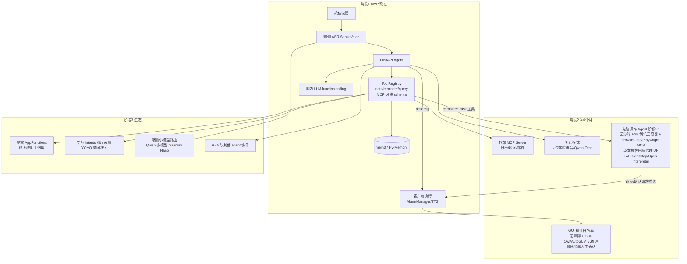

# AI Native 手机端助手：技术架构与方案调研

> 2026-10-17（UTC+8）。依据：[research-v1.md](./research-v1.md)、[design-v1.md](./design-v1.md)。
> 我们已定的方案：Android Kotlin 客户端 + 腾讯云 FastAPI + mem0。
> GitHub 星数和最近提交时间是 2026-10-17 用 GitHub API 实时拉取的。标注“未核实”的内容，本次没有拿到一手资料。

## 1. 三条主流技术路线
| 路线 | 原理 | 代表 | 优点 | 硬伤 |
|---|---|---|---|---|
| **A. GUI 视觉操作** | 截屏或读取控件树，交给 VLM 理解，再规划动作，然后模拟点击和输入 | 豆包手机助手、AutoGLM、Mobile-Agent、Rabbit LAM | 不需要 App 配合，覆盖面理论上是全部 App | 要么需要系统签名权限，要么需要无障碍权限；容易被 App 风控拦截；慢（每一步都要截图并调用云端推理）；脆弱；有隐私风险 |
| **B. 系统 / 应用意图 API** | App 主动声明结构化能力（意图或函数），由系统助手调度 | Apple App Intents、Android AppFunctions、华为 Intents Kit、荣耀 YOYO | 快、稳定、可控，符合平台规则 | 需要生态配合；第三方助手通常拿不到调用权限（要特权或厂商身份） |
| **C. 云端工具调用 + 记忆** | 云端 LLM 做 function calling，调用自有工具或通过 MCP 接入外部服务，再加上长期记忆 | 我们的 design-v1、各类 Chat 助手 | 自己完全掌控，迭代快，记忆能力强 | 操作不了别的 App，只能用自己的能力和开放 API |

## 2. 各方案事实整理
### 2.1 豆包手机助手 × 中兴 nubia（路线 A）
- **发布形态**：2025-12-01 发布 nubia M153 技术预览版工程机，由字节和中兴合作推出。官方定位是让 AI 像人一样跨 App 操作手机（[21世纪经济报道](https://www.21jingji.com/article/20260224/herald/cc6eaebbb6f84c6b5e8317fd5ddbe2d8.html)、[钛媒体](https://www.tmtpost.com/7807590.html)）。
- **用到的系统权限**
  - **INJECT_EVENTS**：签名级（signature）权限，需要用厂商系统私钥签名，并烧录进 ROM。用它来注入点击等输入事件（[第一财经](https://www.yicai.com/news/102939392.html)）。
  - **READ_FRAME_BUFFER 和 CAPTURE_SECURE_VIDEO_OUTPUT**：配合 `WindowManagerService.captureDisplay`，读取三方 App 在**虚拟屏**里运行时的画面，这样操作可以在后台进行。官方称会遵守 Secure 标记，银行键盘这类受保护界面截不到（[豆包官方技术说明](https://mp.weixin.qq.com/s/QuLEnFlKK6OAAvunHFmgOA)）。
- **推理在云端**：官方说明“分析界面所需模型参数较大，暂时无法跑在端侧，截图上传云端处理”，并称任务完成后不存储截图（同上）。
- **生态冲突**：有用户反馈操作微信时被强制退出登录，原因是微信识别到这是模拟输入（[界面新闻](https://www.jiemian.com/article/13717611.html)、[钛媒体](https://www.tmtpost.com/7807590.html)）。
- **行业情况**：21世纪经济报道测评了 7 款手机智能体，几乎都走 GUI 视觉路线。其中荣耀、小米、vivo 主要用无障碍权限读屏，豆包和 OPPO 用更底层的系统服务（[21世纪经济报道](https://www.21jingji.com/article/20260224/herald/cc6eaebbb6f84c6b5e8317fd5ddbe2d8.html)）。
- **对我们的启示**：第三方 App 拿不到 INJECT_EVENTS，**这条路线的天花板掌握在手机厂商手里**。

### 2.2 智谱 AutoGLM / Open-AutoGLM（路线 A，开源）
- 仓库：[zai-org/Open-AutoGLM](https://github.com/zai-org/Open-AutoGLM)，Apache-2.0，26,414 星，最近一次 push 在 2026-03-06。
- 工作方式：用 **AutoGLM-Phone-9B** 这个 VLM 理解截图，**通过 ADB 控制 Android**，也支持 HarmonyOS（HDC）和 iOS（WDA）。文字输入依赖 ADB Keyboard。有敏感操作确认机制，登录或验证码环节可以由人接管。模型有中文版和多语言版两个（[README](https://github.com/zai-org/Open-AutoGLM/blob/main/README_en.md)、[main.py](https://github.com/zai-org/Open-AutoGLM/blob/main/main.py)）。
- 限制：依赖 ADB 和开发者模式，**普通消费者没法直接用**；比较适合做自动化测试或开发者场景。

### 2.3 阿里 Mobile-Agent（路线 A，开源）
- 仓库：[X-PLUG/MobileAgent](https://github.com/x-plug/mobileagent/)，MIT，9,304 星，最近一次 push 在 2026-07-07。
- 组成：Mobile-Agent-v3 是一个多智能体框架，负责规划、进度管理、反思和记忆；底层模型是 **GUI-Owl**（7B、32B，还有 1.5 系列）。已经出到 v3.5，阿里云百炼上提供 API。部署方式同样是 ADB（[v3 README](https://github.com/X-PLUG/MobileAgent/blob/main/Mobile-Agent-v3/README.md)）。

### 2.4 Apple Intelligence（路线 B，加端云结合）
- **App Intents 是接入 Siri AI 和 Apple Intelligence 的唯一途径**。App 用 AppIntent、AppEntity、AppEnum 描述自己的动作和内容，并采用系统定义的 **App Schema** 领域（比如邮件、照片）。Siri 用这些 schema 把自然语言匹配到具体动作上（[Apple 文档](https://developer.apple.com/documentation/AppIntents/apple-intelligence-and-siri-ai)、[WWDC26 Session 240](https://developer.apple.com/videos/play/wwdc2026/240/)）。
- **Private Cloud Compute（PCC）**：用自研 Apple 芯片服务器和加固过的操作系统处理请求，没有远程 shell，个人数据连 Apple 也看不到。Apple 开放了虚拟研究环境（VRE），让安全研究者可以自己验证（[Apple Security Blog](https://security.apple.com/blog/private-cloud-compute/)、[PCC 安全研究](https://security.apple.com/blog/pcc-security-research/)）。
- WWDC26 宣布第三方 App 可以通过 Foundation Models 框架调用 PCC 上的模型：不用 API key，开发者不承担 token 成本，但有配额限制（[WWDC26 Session 319](https://developer.apple.com/videos/play/wwdc2026/319/)）。
- 我们暂时不做 iOS，但它的设计范式值得借鉴：**能端侧就端侧，必须上云时用可验证的隐私云**。

### 2.5 Google Gemini on Android（路线 B，加端侧模型）
- **AppFunctions**：Android 平台 API 加 Jetpack 库，**官方定位是“让 App 像端侧 MCP Server 一样”**，把函数作为工具暴露给 Gemini 等 agent 调用。调用方需要 `EXECUTE_APP_FUNCTIONS` 权限（系统特权级 agent 才有）。截至 2026 年 5 月，和 Gemini 的集成还处在 private preview 阶段（[概览](https://developer.android.com/ai/appfunctions)、[API 参考](https://developer.android.com/reference/android/app/appfunctions/package-summary)）。
- **Gemini Nano**：通过 AICore 系统服务在端侧运行，ML Kit GenAI Prompt API 目前是 Beta，支持结构化输出。限制包括：**只能在 App 处于前台时推理**（后台调用会返回 BACKGROUND_USE_BLOCKED）、每个 App 有调用配额、只支持部分机型（[Gemini Nano](https://developer.android.com/ai/gemini-nano)、[ML Kit GenAI](https://developers.google.com/ml-kit/genai)、[Prompt API](https://developers.google.com/ml-kit/genai/prompt/android)）。另外，**国行手机一般没有 GMS 和 AICore**，这一点是推断，没有找到官方说明。
- **对我们的启示**：我们可以**把自己 App 的记事、提醒、查询能力做成 AppFunctions**，未来让系统助手调用我们；但我们作为第三方去调用别的 App，目前拿不到权限。

### 2.6 华为小艺 Intents Kit、荣耀 YOYO（路线 B）
- **华为 Intents Kit**：开发者按规范声明“端侧意图”或“云侧意图”，HarmonyOS 结合大模型和设备感知，把这些意图分发到小艺对话、小艺搜索、小艺建议等入口；还支持意图共享（数据捐赠）、事件推荐（[华为开发者文档](https://developer.huawei.com/consumer/cn/doc/HarmonyOS-Guides/intents-glossary)）。
- **荣耀 YOYO 智能体**：采用“端（感知）- 脑（调度）- 服（执行）”架构，可以调用后端对接的应用和服务，也能把多个功能组合编排；通过意图框架分发第三方智能体。公开分享里提到的工程难点有节点发现、跨端上下文一致性、任务重规划（Replan）（[新浪/HGDC 2024](https://finance.sina.com.cn/tech/roll/2024-10-28/doc-incucfhz5418105.shtml)、[InfoQ AICon](https://www.infoq.cn/article/2vgS2FNle83YQZrLvxSF)）。
- 这两家的方向都是**以意图框架为主、GUI 兜底**；21世纪经济报道的测评也显示荣耀部分走无障碍权限。

### 2.7 Rabbit r1 / LAM（路线 A 的云端变体）
- LAM（Large Action Model）最早是作为“大动作模型”提出的，后来扩展成一个 agent 系统，由 planner 和 controller 组成，在**云端操作网页和 Web App**；还会根据请求路由到 GPT-4o、Perplexity、Claude 等不同模型（[Moor Insights](https://moorinsightsstrategy.com/rabbit-creates-a-new-kind-of-ai-assistant-in-a-handheld-device/)，这是分析师报告，不是 Rabbit 官方）。
- 用户反馈和后续发展情况，本次没有查到一手来源（未核实）。

### 2.8 MCP / A2A 在移动端
- **MCP**：规范在 [modelcontextprotocol.io](https://modelcontextprotocol.io/)。Google 官方把 AppFunctions 称为“移动端的 MCP 工具等价物”。两者的区别是：AppFunctions 在本机执行，MCP Server 通常跑在云端、要走网络往返（[Android 文档](https://developer.android.com/ai/appfunctions)）。
- **A2A（Agent2Agent）**：一个开放的 agent 间通信协议，规范在 [a2a-protocol.org](https://a2a-protocol.org/)。有资料说它在 2025 年 6 月捐给了 Linux Foundation，但这个说法来自二手资料，未核实。手机端怎么落地，**目前没有看到成熟案例**。
- **对我们的建议**：服务端把工具层做成 MCP 风格，统一用 schema 描述工具，方便以后接外部 MCP Server（比如日历、地图）。A2A 先观望。

## 3. 实时语音：端到端语音大模型
| 方案 | 形态 | 来源 |
|---|---|---|
| OpenAI Realtime（gpt-realtime） | 通过 WebRTC 或 WebSocket 做语音到语音，支持工具调用、MCP 和语义 VAD | [官方指南](https://developers.openai.com/api/docs/guides/realtime)；国内访问和合规有障碍 |
| 豆包实时语音大模型 | 端到端语音，低时延，可以随时打断，能联网；火山引擎有 API | [豆包公告](https://mp.weixin.qq.com/s/CIiS5WJO7u97sJ9Ui2dtTw)、[火山引擎文档](https://www.volcengine.com/docs/6561/1594356)（页面能打开，内容没逐条核对） |
| Qwen3-Omni | 开源的端到端全模态模型，支持流式输出；百炼提供 Realtime API | [QwenLM/Qwen3-Omni](https://github.com/QwenLM/Qwen3-Omni/)（Apache-2.0，4,060 星）、[百炼 Realtime](https://help.aliyun.com/zh/model-studio/realtime) |

**和我们“ASR + LLM + TTS 级联”方案的对比**
- 端到端方案的优势：延迟和打断体验好，情感表达更自然。
- 端到端方案的劣势：音频必须上云，这和“音频不出手机”的原则冲突；工具调用和记忆写入不如文本链路可控；按音频时长计费，成本更高。
- **结论**：MVP 继续用级联方案。后期可以加一个“对话模式”，用端到端模型做闲聊和问答，记事和提醒仍然走文本链路。

## 4. 对我们方案的建议
### 4.1 MVP 现在就该吸收的设计
1. **意图即工具（借鉴 B 路线和 MCP）**
   - 把 note、reminder、query 定义成带 JSON Schema 的工具，用 LLM function calling 来选工具，替换掉 design-v1 里的“分类 + 槽位”自定义格式。以后加新能力只需要加一个工具。
   - 服务端设一个 `ToolRegistry`，工具的描述格式兼容 MCP。
2. **端侧执行、云端推理（借鉴豆包 / PCC 的分工）**：云端只返回结构化动作，客户端执行。比如提醒由客户端用 AlarmManager 设置。现在的设计已经是这样，要保持住。
3. **人在回路（借鉴 AutoGLM 的敏感操作确认）**：有副作用的动作要先确认，比如删除记忆、批量修改；语音播报“已设置×××”，并允许一键撤销。
4. **隐私分层（借鉴 PCC）**：音频不出手机；把数据处理流向写进隐私政策；同步交互链路里不做持久化日志。
5. **计划和执行解耦**：响应里返回一个 `actions[]` 数组，而不是只有一个动作，为以后多步任务做准备。

### 4.2 留到后期
| 能力 | 时机 | 原因 |
|---|---|---|
| 暴露 AppFunctions（让 Gemini 或系统助手调用我们） | AppFunctions 在国内机型可用之后 | 目前还是 private preview，国内机型基本没有 GMS |
| 接入华为 Intents Kit 或荣耀 YOYO 意图框架 | 有用户规模之后 | 要去各家开放平台入驻，每家单独适配 |
| GUI 操作别的 App（无障碍服务，加 GUI-Owl 或 AutoGLM 云端推理） | 第二阶段，只做白名单场景 | 有应用商店审核、App 风控（微信）、隐私和合规风险，延迟也高 |
| 端到端实时语音对话模式 | 第二阶段 | 成本高，音频要上云 |
| 接外部 MCP Server（日历、地图、邮件） | 第二阶段 | 先把 ToolRegistry 做好 |
| A2A | 观望 | 移动端还没有成熟实践 |
| 端侧 LLM（Qwen 小模型、Gemini Nano） | 有数据之后 | Gemini Nano 只能在前台用、只支持部分机型；国内机型不确定 |

### 4.3 演进架构图

### 4.4 design-v1 需要做的修改
1. `/v1/utterances` 的响应改成 `{intent, actions:[{type, params, needs_confirm}], speak}`。
2. 意图分类改成：规则快路径，加上 LLM tool calling。
3. 服务端新增 `ToolRegistry` 模块，仓库里加一个 `server/app/tools/` 目录。

## 5. 电脑操作 Agent：手机语音下指令，让云端或本地电脑去执行

### 5.1 各方案事实整理
| 方案 | 形态 | 执行环境 | 安全与确认机制 | 来源 |
|---|---|---|---|---|
| **Anthropic Computer Use** | API 客户端工具集（`computer_toolset_20260801`，包含 screenshot、left_click、type、zoom 等 17 个成员工具） | **由我们自己控制的环境**（VM 或容器），我们负责执行动作、回传截图，形成 agent loop | 官方建议在沙箱里运行；目前不支持 Managed Agents | [Claude 文档](https://platform.claude.com/docs/en/agents-and-tools/tool-use/computer-use-tool) |
| **OpenAI Computer Use / CUA** | Responses 的 `computer` 工具返回结构化动作（click、type、scroll 等）；新模型更推荐“代码执行”方式，即生成 Playwright 或 PyAutoGUI 代码 | 我们自己执行；**Agents API 也可以用 OpenAI 托管的浏览器**（`openai_hosted`） | 托管浏览器访问每个新域名前都要用户批准，登录也要用户来做 | [Computer use 指南](https://developers.openai.com/api/docs/guides/tools-computer-use)、[Agents API](https://developers.openai.com/api/docs/guides/agents-api/tools/computer-use) |
| **ChatGPT 桌面版 Computer Use** | 桌面 App 插件，macOS 和 Windows 都支持 | **用户本机**；也可以跑在 Windows 虚拟机里；**支持从手机远程控制、查看进度** | 按 App 逐个授权（可以选“始终允许”）；macOS 需要屏幕录制和辅助功能权限 | [ChatGPT Learn](https://learn.chatgpt.com/docs/computer-use) |
| **Manus** | 通用云端 agent，交付成果物（报告、表格、网站） | 云端隔离的 Ubuntu VM，带浏览器、终端、文件系统 | 平台托管 | [manus.im](https://manus.im/compare/manus-vs-claude-code) |
| **智谱 GLM-PC**（电脑版；AutoGLM 主要做手机和网页） | 基于 CogAgent 的电脑智能体，支持 Mac 和 Windows | 用户本机；有“隐形屏幕”，在后台执行；**手机可以远程下指令**，每一步都回传截图 | 遇到敏感操作会暂停，等用户确认 | [智谱官方](https://www.zhipuai.cn/zh/news/68)、[GLM-PC v1.1](https://developer.volcengine.com/articles/7464068947613548563)、[IT之家](https://www.ithome.com/0/826/718.htm) |
| **字节 UI-TARS / UI-TARS-desktop** | 开源 GUI agent 模型和桌面端 agent 套件 | 本机桌面或浏览器 | 我们自己实现 | [UI-TARS](https://github.com/bytedance/UI-TARS)（Apache-2.0，11.6K 星，最近提交 2026-01）、[UI-TARS-desktop](https://github.com/bytedance/UI-TARS-desktop)（Apache-2.0，39.3K 星，最近提交 2026-10-09） |
| **browser-use** | Python 浏览器 agent 库，另有云端托管服务 | 本地 Playwright 或云端浏览器 | 我们自己实现 | [browser-use](https://github.com/browser-use/browser-use)（MIT，118K 星，最近提交 2026-10-16） |
| **Playwright MCP** | 以 MCP Server 的形式提供浏览器操作，基于可访问性树，不依赖截图 | 本地或服务器上的无头浏览器 | 我们自己实现 | [microsoft/playwright-mcp](https://github.com/microsoft/playwright-mcp)（Apache-2.0，38.2K 星，最近提交 2026-10-08） |
| **E2B Desktop** | 带图形桌面的云沙箱，可以接任何 LLM | E2B 云端或自托管 | 沙箱隔离 | [e2b-dev/desktop](https://github.com/e2b-dev/desktop)（Apache-2.0，1.5K 星，最近提交 2026-10-15） |
| **Open Interpreter** | 让 LLM 在本机执行代码或命令来操作电脑 | 用户本机 | 默认执行前要确认（详细机制未核实） | [openinterpreter](https://github.com/openinterpreter/openinterpreter)（Apache-2.0，68.6K 星，最近提交 2026-10-11） |

### 5.2 云端虚拟桌面 vs 用户本机客户端代理
| 维度 | 云端虚拟桌面或浏览器（E2B、腾讯云容器、OpenAI 托管、Manus） | 用户本机客户端代理（ChatGPT 桌面、GLM-PC、UI-TARS-desktop、Open Interpreter） |
|---|---|---|
| 能访问什么 | 公网网页和公开服务；用户账号要在沙箱里重新登录 | 用户已经登录的 App、本地文件、内网，能力最强 |
| 隐私与风险 | 和用户本机隔离，最坏情况下影响只局限在沙箱里 | 误操作或被 prompt 注入时，会直接影响真实数据和账号 |
| 是否在线 | 7×24 在线，不依赖用户开着电脑 | 需要电脑开机、联网、不锁屏（ChatGPT 文档里也是这么要求的） |
| 成本 | 按沙箱运行时长计费，加上 VLM 推理费用 | 用户自己的电脑，我们只承担推理费用 |
| 工程量 | 服务端要做沙箱编排 | 要开发 Win、Mac 客户端，做设备配对和反向通道（WebSocket） |
| 适合的任务 | 网页调研、比价、填写公开表单、生成文件 | 操作本机办公软件、整理文件、在已登录的网站上执行 |

**建议**：先上云端浏览器沙箱，因为风险最低，而且能复用腾讯云。等用户量起来后，再做本机代理，配上严格的白名单和确认机制。

### 5.3 安全与确认机制（不管哪条路线都必须有）
1. **分级授权**
   - 只读类（浏览、搜索、截图）：可以自动执行。
   - 写入类（提交表单、发消息、编辑文件）：要在手机上确认。
   - 高风险类（支付、转账、删除、修改密码、对外发送）：每次都要确认，并且要在手机上做生物识别验证；这一类默认禁用。
2. **白名单**：本机代理要设置 App 白名单（参考 ChatGPT 逐个 App 授权的做法）；云沙箱要设置域名白名单（参考 OpenAI 的 origin approval）。
3. **全程可见、可中断**：每一步截图都推送到手机，用户可以一键“停止”或“接管”（参考 GLM-PC 每步回传截图的做法）。
4. **凭据隔离**：agent 永远拿不到密码；登录由用户亲自完成（参考 OpenAI 的 browser_authentication）；沙箱任务结束后就销毁。
5. **防 prompt 注入**：网页和屏幕上的文字都当作数据处理，不当作指令；大模型想做计划外的动作时，必须重新确认。
6. **审计**：记录每个任务的动作日志和截图，保留时间有上限（比如 7 天），用户可以删除。
7. **预算上限**：限制每个任务的最大步数、最长时长和费用（参考 Open-AutoGLM 的 MAX_STEPS 默认 100）。

### 5.4 怎么接进我们的腾讯云服务端
- **接入方式**：在 ToolRegistry 里新增一个 `computer_task` 工具，参数是 `{goal, target:"cloud"|"my_pc", risk_level}`。它是**异步任务**：服务端返回 task_id，进度通过 FCM 或国内推送、以及 WebSocket 推到手机上。
- **云端执行器（阶段 2b）**
  - 运行环境：腾讯云上开一个独立的 worker 节点池，每个任务起一个容器，里面跑 Playwright 无头浏览器。
  - 浏览器 agent：可以用 browser-use，也可以用 Playwright MCP 加我们自己的 LLM。
  - 需要完整桌面时：用 E2B Desktop，或者自建 Xvfb 容器。
  - **执行器要和 API 主机、数据库网络隔离**，外网出口也要受控。
- **模型选择**：浏览器任务优先走基于可访问性树的文本方案（Playwright MCP），更便宜、更稳定。确实需要视觉理解时，用 UI-TARS 或 GUI-Owl（可以自己部署在 GPU 上），或者走商用 CUA API。国内能不能合规使用海外 API，需要另外评估。
- **本机代理（阶段 3）**：开发一个轻量桌面客户端（可以基于 UI-TARS-desktop 或 Open Interpreter 二次开发）。它主动用 WebSocket 连到我们的服务端，服务端不需要访问用户内网。设备配对用一次性码加设备证书。
- **阶段安排**：**这部分放在 MVP 之后的阶段 2b（大约第 2–3 个月）**。前提有两个：MVP 的记事、提醒、问答已经稳定，而且 `actions[]` 和异步任务推送已经做好。MVP 期间不做。
