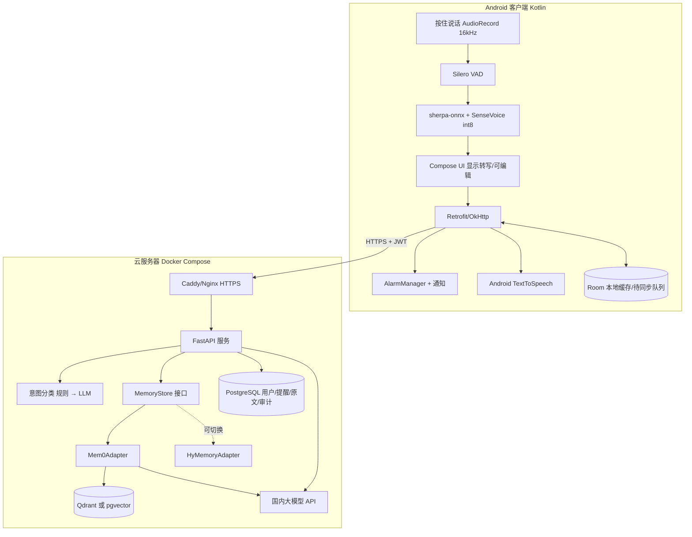

# 移动端语音个人 Agent —— 设计文档 v1

> 日期：2026-10-17（UTC+8）
> 依据：[research-v1.md](./research-v1.md)
> 已定方案：**Android 客户端 + 云服务器服务端**
> 本文只做设计，不包含代码，也不建仓库。

## 0. 目标与范围
- **MVP 做三件事**
  - 语音记事：说一句话，记成一条记忆。
  - 语音提醒：在手机本地定时通知，同时把提醒写进记忆。
  - 基于记忆的问答：检索记忆，交给 LLM 生成回答，再用 TTS 播报。
- **暂不做**：唤醒词、后台常开收音、iOS、多设备同步、端到端语音大模型。

## 1. 系统架构


**一次请求的流程**
1. 用户按住按钮说话，松开后在端侧完成识别，得到文本。
2. 客户端调用 `POST /v1/utterances`，把文本和本地时间发给服务端。
3. 服务端做意图分类，然后按意图执行：
   - 记事：写入记忆。
   - 提醒：把时间解析成结构化数据，写库，并在响应里告诉客户端怎么排程。
   - 问答：检索记忆，生成回答。
4. 客户端根据响应执行动作：本地设闹钟，或者用 TTS 播报回答。

**设计原则**
- **音频不上传**：语音只在端侧识别，服务端只收文本。
- 服务端只负责记忆和推理；提醒由客户端本地触发，所以断网时也能按时响。

## 2. 客户端技术栈（Android）
| 模块 | 选型 | 说明 |
|---|---|---|
| 语言 / UI | Kotlin + Jetpack Compose，minSdk 26 | |
| 录音 | AudioRecord，16kHz，单声道 PCM | 按住说话：按下开始录，松开结束；单次最长 60 秒 |
| VAD | sherpa-onnx 自带的 Silero VAD | 裁掉首尾静音 |
| ASR | [sherpa-onnx](https://github.com/k2-fsa/sherpa-onnx) Android AAR + SenseVoice int8（约 240MB，打开逆文本规范化 ITN） | 首次启动时下载模型，或用 Play Asset Delivery 分发；目标是 10 秒语音在 1.5 秒内出结果（中端机上实测） |
| 转写确认 | 识别结果显示 2 秒后自动提交，期间可以点一下进入编辑 | 降低识别错误带来的影响 |
| 网络 | Retrofit + OkHttp + kotlinx.serialization | |
| 本地存储 | Room（离线队列、提醒镜像）+ EncryptedSharedPreferences（存 token） | |
| 提醒 | AlarmManager `setExactAndAllowWhileIdle` + NotificationManager；开机后用 BOOT_COMPLETED 重新排程 | Android 12 以上需要“精确闹钟”权限，Android 13 以上需要通知权限 |
| TTS | 系统 TextToSpeech（中文） | 后续可以换云端 TTS |
| 依赖注入 / 异步 | Hilt + Coroutines/Flow | |

## 3. 服务端技术栈
| 模块 | 选型 |
|---|---|
| Web 框架 | Python 3.11 + FastAPI + Uvicorn，用 Pydantic v2 做校验 |
| 数据库 | PostgreSQL 16，表包括 users、devices、utterances、reminders、audit_log；向量库 MVP 用 Qdrant，也可以用 pgvector 合进 PG 来减少一个组件 |
| 记忆 | `MemoryStore` 抽象接口，默认实现 `Mem0Adapter`（[mem0](https://github.com/mem0ai/mem0)，Apache-2.0），预留 `HyMemoryAdapter`（[hy-memory](https://pypi.org/project/hy-memory/)，MIT） |
| LLM 调用 | 一个统一的 `LLMClient`，走 OpenAI 兼容协议，通过配置切换供应商；用 function calling 或 JSON 模式输出结构化结果 |
| 时间解析 | 用 LLM 抽取 ISO 8601 时间，再用规则校验（不能是过去的时间，时区默认 Asia/Shanghai） |
| 鉴权 | JWT：access token 有效期 15 分钟，refresh token 30 天 |
| 观测 | 结构化日志（不记录原文）、Prometheus 指标（可选） |

**MemoryStore 接口（伪签名，只说明设计）**
- `add(user_id, text, metadata) -> [MemoryItem]`
- `search(user_id, query, top_k) -> [MemoryItem(id, text, score, created_at, source_utterance_id)]`
- `list(user_id, cursor)`
- `update(user_id, memory_id, text)`
- `delete(user_id, memory_id)`
- `delete_all(user_id)`

所有业务代码只依赖这个接口。用 `MEMORY_BACKEND=mem0|hymemory` 切换实现。有一个评测脚本，用同一份问答集对比两个后端的召回率。

## 4. API 接口定义（v1）
- **通用约定**
  - 基础地址：`https://api.<域名>/v1`，只走 HTTPS。
  - 请求头：`Authorization: Bearer <access_token>`。
  - 写操作都带 `X-Request-Id`（UUID），服务端据此保证幂等。
- **错误格式**：`{"error":{"code":"INVALID_ARGUMENT","message":"..."}}`，HTTP 状态码按语义使用（400、401、403、404、409、429、500）。

### 4.1 鉴权
**`POST /v1/auth/login`**
MVP 用邀请码 + 设备注册登录，后续再接手机号验证码。

请求：
```json
{"invite_code":"ABCD-1234","device_id":"uuid","device_name":"Pixel 8"}
```
响应 200：
```json
{"access_token":"jwt","refresh_token":"jwt","expires_in":900,"user_id":"u_123"}
```

**`POST /v1/auth/refresh`**
请求：`{"refresh_token":"jwt"}`
响应：同上。

**`POST /v1/auth/logout`**
吊销当前设备的 refresh token。

### 4.2 核心接口：提交一句话
**`POST /v1/utterances`**

请求：
```json
{
  "text": "明天下午三点提醒我给张总回电话",
  "client_time": "2026-10-17T10:00:00+08:00",
  "timezone": "Asia/Shanghai",
  "asr": {"engine":"sensevoice","confidence":0.92,"duration_ms":2300},
  "hint_intent": null
}
```

响应 200，按意图返回其中一种：

记事：
```json
{"utterance_id":"utt_1","intent":"note","confidence":0.95,
 "result":{"memories":[{"id":"m_1","text":"车停在B2区35号"}]},
 "speak":"好的，记下了。"}
```

提醒：
```json
{"utterance_id":"utt_2","intent":"reminder","confidence":0.97,
 "result":{"reminder":{"id":"r_1","title":"给张总回电话",
   "fire_at":"2026-10-18T15:00:00+08:00","repeat":null,"status":"scheduled"}},
 "speak":"好的，明天下午3点提醒你给张总回电话。"}
```

问答：
```json
{"utterance_id":"utt_3","intent":"query","confidence":0.9,
 "result":{"answer":"你的车停在B2区35号。",
   "citations":[{"memory_id":"m_1","text":"车停在B2区35号","created_at":"2026-10-17T09:12:00+08:00"}]},
 "speak":"你的车停在B2区35号。"}
```

意图不明确时，返回 `intent:"clarify"` 和 `speak:"你是想记下来，还是设个提醒？"`。

### 4.3 记忆管理
**`GET /v1/memories?cursor=&limit=20`**
响应：
```json
{"items":[{"id":"m_1","text":"...","created_at":"..."}],"next_cursor":null}
```

**`PATCH /v1/memories/{id}`**
请求：`{"text":"车停在B3区12号"}`

**`DELETE /v1/memories/{id}`**
删除单条，返回 204。

**`DELETE /v1/memories`**
清空全部记忆。请求体：`{"confirm":"DELETE_ALL"}`，返回 204。

### 4.4 提醒
**`GET /v1/reminders?status=scheduled`**
用于客户端对账和重新排程。

**`PATCH /v1/reminders/{id}`**
请求：`{"status":"done"}`，status 可选 done / cancelled / snoozed；也可以传 `{"fire_at":"..."}` 改时间。

**`DELETE /v1/reminders/{id}`**

### 4.5 账户
**`GET /v1/me`**

**`DELETE /v1/me`**
注销账户：删除全部数据，包括记忆、原文和向量。

**`GET /v1/me/export`**
以 JSON 导出全部记忆和提醒。

## 5. 意图分类
| 意图 | 定义 | 触发示例 | 动作 |
|---|---|---|---|
| `note` 记事 | 陈述一个想留存的事实 | “记一下…”“我把护照放在书房抽屉” | 写入 MemoryStore（同时保留原文） |
| `reminder` 提醒 | 包含将来某个时间点要做的事 | “明天三点提醒我…”“每周一早上九点…” | 解析出 title、fire_at、repeat，写入 reminders 表；同时写一条记忆 |
| `query` 问答 | 向自己的记忆提问 | “我车停哪了？”“上周我答应张总什么？” | 检索 top_k=8 条记忆，交给 LLM 回答，并附上引用 |
| `clarify` | 置信度低于 0.6，或缺少必要信息（比如提醒没说时间） | “张总那个事” | 让用户澄清 |

**分类流程**
1. **规则层**：用正则和关键词匹配，比如“提醒我/叫我/闹钟”判为提醒，“记一下/记住”判为记事，以“吗、什么、哪、几点、？”结尾判为问答。命中规则且时间能解析时直接返回，不调用 LLM。
2. **LLM 层**：规则没命中时调用 LLM，一次调用同时完成分类和槽位抽取，按 JSON Schema 输出：`{intent, confidence, title?, fire_at?, repeat?, memory_text?}`。
3. **评测**：建一个包含 200 条中文口语样本的标注集，目标准确率 ≥95%，提醒时间解析正确率 ≥95%。
4. **后续优化**：端侧 Qwen2.5-0.5B 先不上，等积累了数据再考虑把规则层下放到端侧（参见 research-v1 第 3.3 节）。

## 6. 云服务器部署方案
### 6.1 Docker Compose 服务
| 服务 | 镜像 | 说明 |
|---|---|---|
| caddy | caddy:2 | 自动申请 HTTPS 证书，反向代理到 api |
| api | 自建（python:3.11-slim） | FastAPI，2 个 worker |
| postgres | postgres:16 | 数据卷持久化，每天 pg_dump 备份 |
| qdrant | qdrant/qdrant | 如果选 pgvector 就去掉这个服务 |
| （可选）redis | redis:7 | 限流和幂等键 |

密钥统一放在 `.env` 里（LLM_API_KEY、JWT_SECRET、DB 密码），不提交到 git。

### 6.2 配置要求（MVP，少于 100 个用户）
- 2 核 4GB 内存，硬盘 60GB SSD，带宽 3–5Mbps，Ubuntu 22.04/24.04。服务端不跑本地模型，所以不需要 GPU。
- 后续如果要自己部署 Hy-Memory-30B-A3B，需要单独准备 GPU 机器（参见 research-v1 第 1.4 节），MVP 阶段不做。
- 地域选在中国大陆，满足数据境内存储的要求。用域名对外提供服务要先做 **ICP 备案**（大约需要 1–3 周，要尽早启动）；备案期间可以先用 IP 加自签证书做内测。

### 6.3 国内大模型 API 候选
都走 OpenAI 兼容接口，通过配置切换。价格和型号变化快，**下单前请以各家官网为准**，这里不列价格。
| 供应商 | 适用 | 备注 |
|---|---|---|
| 腾讯混元 | 和 Hy-Memory 同属腾讯生态 | 如果选腾讯云，可以走内网或同一个账号 |
| 阿里云百炼 · 通义千问 | 意图和抽取用小模型，问答用中等模型 | 有 Qwen 系列不同规格可选 |
| DeepSeek | 性价比高 | 高峰期可能限流 |
| 火山方舟 · 豆包 | 延迟低 | |

**建议**：意图和抽取用便宜的快模型，问答用中等模型；准备一个主供应商和一个备用供应商，自动切换。

## 7. 隐私与安全
1. **数据最小化**：音频只在端侧处理，从不上传；服务端只存文本。日志里不出现原文，只记录 utterance_id。
2. **传输与存储**：全链路 TLS；PostgreSQL 数据盘用云盘加密；敏感字段（原文）在应用层用 AES-GCM 加密，密钥放在 KMS 或 `.env`。
3. **用户控制权**：可以查看、修改、删除单条记忆；可以一键清空；可以注销账户（硬删除，包括向量和备份按周期轮换掉）；可以导出 JSON。
4. **告知与同意**：首次启动时展示隐私政策，并单独同意“个人信息处理 + 调用第三方大模型”。政策里要列出所用 LLM 供应商的名单（《个人信息保护法》的要求）。
5. **第三方模型**：选择不使用请求数据做训练的企业接口或选项（以合同和控制台设置为准）。
6. **鉴权安全**：JWT 短时效，refresh token 和设备绑定、可以吊销；按用户限流；邀请码控制内测范围。
7. **防注入**：记忆内容放进 prompt 时作为数据隔离，LLM 只能输出固定 schema，没有任何可执行的工具权限。
8. **客户端**：token 存在 EncryptedSharedPreferences 里；`allowBackup=false`；发布版做混淆。

## 8. 仓库结构建议（monorepo）
```
qh-personal-agent/
├── android/                 # Kotlin + Compose 客户端
│   ├── app/
│   └── feature-asr/         # sherpa-onnx 封装与模型下载
├── server/                  # FastAPI
│   ├── app/api/             # 路由
│   ├── app/intent/          # 规则 + LLM 分类
│   ├── app/memory/          # MemoryStore + mem0/hymemory 适配器
│   ├── app/llm/             # LLMClient（OpenAI 兼容）
│   ├── app/db/              # 模型与迁移（Alembic）
│   └── tests/
├── deploy/                  # docker-compose.yml、Caddyfile、.env.example、备份脚本
├── eval/                    # 意图与记忆问答评测集、脚本
├── docs/                    # research-v1.md、design-v1.md、api.md（OpenAPI 导出）
└── README.md
```

## 9. 第一周任务（按天拆）
| 天 | 客户端 | 服务端 / 运维 | 当天验收 |
|---|---|---|---|
| D1 | 建 Android 工程，搭好 Compose 骨架和按住说话录音 | 购买云服务器，启动 ICP 备案；建好仓库骨架、docker-compose（caddy、api、postgres、qdrant） | 录音能保存成 wav；服务器上 `/healthz` 能访问 |
| D2 | 集成 sherpa-onnx AAR 和 SenseVoice 模型，接入 VAD，完成离线识别 | 建数据库表和 Alembic 迁移；完成 JWT 鉴权（login、refresh） | 在 2 台真机上测中文识别延迟和字错率（20 句） |
| D3 | 转写确认 UI，接入 Retrofit，实现登录 | `LLMClient`（主备供应商）；意图规则层加 LLM 层；`POST /v1/utterances` 返回意图 | 手机说一句话，能拿到正确的意图 JSON |
| D4 | 写好 note 和 query 的处理分支，用 TTS 播报 `speak` 字段 | 完成 `MemoryStore` 接口和 Mem0Adapter；完成 note 和 query 两条链路 | 说一句话记下来，再问能答对（周验收的核心） |
| D5 | Room 离线队列；记忆列表页，支持删除 | 记忆管理 API；建 50 条意图评测集并跑出第一版结果；完成部署脚本和每日备份 | 端到端演示；把意图准确率和识别延迟写成周报 |

（提醒相关的 AlarmManager、时间解析、`/v1/reminders` 放在第 2 周 D6–D7，和 research-v1 第 4.4 节的安排一致。）

## 10. 待用户决定的事项
1. **云厂商和地域**：腾讯云、阿里云还是火山引擎，选哪个大陆地域；ICP 备案用什么主体（个人还是公司），用哪个域名。
2. **大模型 API**：主供应商和备用供应商怎么选；是否接受文本发给第三方模型（这会影响隐私政策的写法）。
3. **记忆后端**：默认用 mem0、把 Hy-Memory 作为 A/B（本文推荐的方案），还是一开始就直接用 Hy-Memory。
4. **向量库**：Qdrant（多一个组件）还是 pgvector（合进 PG，运维简单）。
5. **登录方式**：MVP 用邀请码，还是直接做手机号验证码（需要短信服务和对应资质）。
6. **仓库**：仓库名（建议 `qh-personal-agent`）、放在 GitHub 还是国内代码托管平台、公开还是私有、用哪个开源协议。
7. **ASR 模型分发**：约 240MB 的模型是首次启动时下载，还是直接打进 APK 或用 Play Asset Delivery（国内应用商店要另外处理）。
8. **最低支持的 Android 版本和测试机型**：建议 Android 8 以上（minSdk 26），至少准备 1 台中端机和 1 台低端机。
9. **应用名和品牌**：App 名称和唤醒称呼（为以后做唤醒词预留）。
