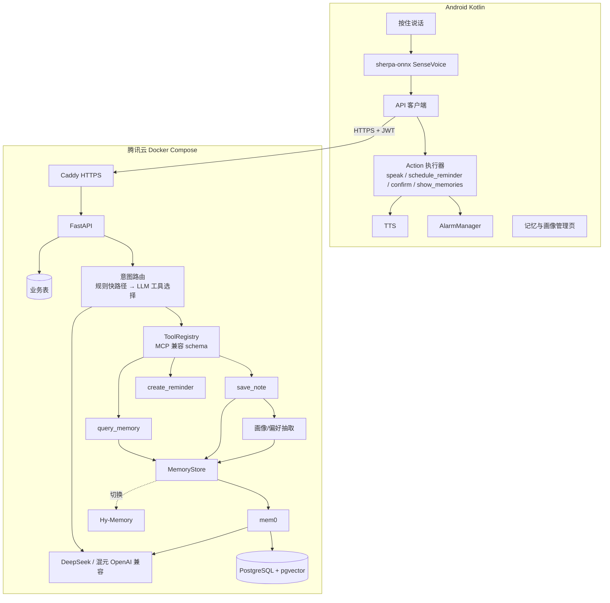

# 语音个人助理 —— 设计文档 v2

> 日期：2026-10-17（UTC+8）
> 依据：[design-v1.md](./design-v1.md)、[research-v1.md](./research-v1.md)、[ai-native-arch.md](./ai-native-arch.md)
> 相比 v1 的变化：增加产品定位；技术栈定版；接口改为返回 `actions[]` 加确认标记；新增 ToolRegistry，工具 schema 兼容 MCP；强化“更懂我”；操作手机和操作电脑都移到远期。

## 0. 定位与范围
**定位：一个更懂我、以语音交互为主、基于开源技术的移动助理。**

**第一版只做两件事**
- **记忆和“懂我”**：抽取用户画像和偏好；记忆能更新、能遗忘；用户可以查看和编辑。
- **语音交互**：按住说话，端侧识别，语音播报。

功能保留三个：**记事、提醒、基于记忆的问答**。

**明确推到远期，第一版不做**
- 手机操作：GUI 自动化、无障碍服务、系统意图调用（AppFunctions、Intents Kit 等）。
- 电脑操作：云沙箱或本机代理（见 ai-native-arch 第 5 章）。
- 端到端实时语音、唤醒词、iOS。

## 1. 技术栈（定版）
| 层 | 选型 |
|---|---|
| 客户端 | 原生 Kotlin + Jetpack Compose；sherpa-onnx + SenseVoice int8（端侧识别）；AlarmManager（本地提醒）；系统 TTS；Room 和 EncryptedSharedPreferences |
| 服务端 | Python 3.12 + FastAPI + SQLAlchemy 2（async） |
| 数据 | PostgreSQL 16 + pgvector。业务表和 mem0 的向量共用一个库，不再单独部署 Qdrant |
| 记忆 | `MemoryStore` 接口，默认实现是 mem0，可以切换到 Hy-Memory |
| LLM | OpenAI 兼容接口，通过配置切换 DeepSeek 或腾讯混元；没有密钥时用 mock |
| 部署 | 腾讯云 CVM（大陆地域）+ Docker Compose + Caddy（自动 HTTPS） |

## 2. 架构


## 3. “更懂我”：记忆设计
### 3.1 记忆分类
| type | 内容 | 例子 | 怎么产生 |
|---|---|---|---|
| `fact` | 一次性事实 | 车停在 B2-35 | 记事 |
| `profile` | 稳定的画像信息 | 住在杭州；女儿叫小米 | 从记事和对话里抽取 |
| `preference` | 偏好 | 不喝咖啡；提醒要提前 10 分钟 | 抽取，或用户明确说出来 |
| `event` | 有时间的事件和承诺 | 答应周五给张总回电话 | 由提醒生成 |

### 3.2 抽取
- 每次处理 note 和 reminder 时，异步跑一次抽取：LLM 按 schema 输出 `[{type, key, value, confidence}]`。置信度低于 0.7 的不写入。
- 画像用 `key` 去重，比如 `home_city`。

### 3.3 更新与遗忘
- **冲突更新**：新写入的记忆和旧记忆的相似度超过阈值、并且同一个 key 的值变了，就用新的覆盖旧的，旧值保留在历史里。mem0 自带 ADD/UPDATE/DELETE 判断，可以直接复用。
- **时效遗忘**：每条 `fact` 和 `event` 带一个 `expires_at`。比如“车位”默认 3 天后过期，过期的事件在检索时降权，30 天后归档。
- **用户主动遗忘**：用户说“忘掉…”时，先检索出匹配的记忆，经过确认后删除。
- **检索打分**：`score = 相似度 × 时间衰减 × 类型权重`，profile 和 preference 的权重最高。

### 3.4 用户掌控
- App 里有“我的记忆”页面：可以按类型查看、编辑、删除，能看到每条记忆的来源原话和时间。
- “我的画像”页面：用卡片展示 profile 和 preference，可以修改，也可以选“不要再记这类信息”（屏蔽某个 key）。
- 可以一键清空、导出 JSON、注销账户。

## 4. ToolRegistry 与 actions
- 每个工具包含 `name`、`description`、`input_schema`（JSON Schema）。注册表能导出两种格式：OpenAI tools 格式（给 LLM 做 function calling）和 MCP `tools/list` 格式，方便以后对外提供 MCP Server。
- 第一版内置的工具：`save_note`、`create_reminder`、`query_memory`、`forget_memory`（这一个需要确认）。
- **意图路由流程**
  1. 先走规则快路径（关键词加时间解析），命中就直接调用对应工具。
  2. 没命中时，让 LLM 带着工具列表做 function calling。
  3. 两步都失败，返回 `clarify`。

### 4.1 `POST /v1/utterances` 响应格式（取代 v1 的单一 result）
```json
{
  "utterance_id": "utt_2",
  "intent": "reminder",
  "confidence": 0.97,
  "actions": [
    {"type": "schedule_reminder",
     "params": {"id": "r_1", "title": "给张总回电话", "fire_at": "2026-10-18T15:00:00+08:00"},
     "needs_confirm": false},
    {"type": "speak",
     "params": {"text": "好的，明天下午3点提醒你给张总回电话。"},
     "needs_confirm": false}
  ],
  "speak": "好的，明天下午3点提醒你给张总回电话。",
  "citations": []
}
```

- **action 类型**：`speak`、`schedule_reminder`、`cancel_reminder`、`show_memories`、`confirm`。
- **`needs_confirm=true` 时**：客户端先播报确认问题。用户确认后，客户端调用 `POST /v1/actions/{id}/confirm` 再执行。删除记忆、批量修改都属于这一类。

### 4.2 其他接口
其他接口沿用 v1：auth、memories、reminders、me、export。新增下面几个：
- `GET /v1/me/profile`：返回画像卡片。
- `PATCH /v1/me/profile/{key}`：修改某项画像。
- `POST /v1/me/profile/blocklist`：屏蔽某个 key，以后不再记录这类信息。
- `POST /v1/actions/{id}/confirm`：确认一个需要确认的动作。

## 5. 隐私与安全（在 v1 基础上补充）
- 音频不出手机；服务端只收文本。
- 画像抽取的结果全部对用户可见、可编辑。敏感类别（健康、宗教、政治、性取向、财务账号）**默认不抽取**。
- LLM 供应商限定为国内的 DeepSeek 或混元，并在隐私政策里列明。

## 6. 部署
- **服务**：caddy、api、postgres（镜像用 `pgvector/pgvector:pg16`）。
- **配置**：2 核 4GB 内存，硬盘 60GB SSD；腾讯云大陆地域；用域名对外服务要先做 ICP 备案。

## 7. 路线图
| 阶段 | 内容 |
|---|---|
| **v1（现在，2 周）** | 语音记事、提醒、问答；画像抽取；记忆的更新与遗忘；记忆和画像管理页 |
| v1.5 | 主动提醒（基于画像和事件）、每周记忆回顾、Hy-Memory A/B、端侧意图快路径 |
| 远期 | 端到端实时语音对话；外部 MCP 工具（日历、地图）；**手机操作**（无障碍、GUI agent、AppFunctions 或 Intents Kit）；**电脑操作**（云沙箱或本机代理） |

## 8. 第一周任务（按天）
| 天 | 客户端 | 服务端 |
|---|---|---|
| D1 | 建工程，做按住说话录音 | 服务端骨架已完成（`server/`），购买腾讯云服务器，启动 ICP 备案 |
| D2 | 接入 sherpa-onnx 和 SenseVoice，在真机上测中文识别 | 接入真实 LLM 密钥，用 mem0 + pgvector 联调 |
| D3 | 登录，调用 `/v1/utterances`，实现 Action 执行器 | 实现画像抽取和冲突更新 |
| D4 | 实现 AlarmManager 提醒和 TTS | 时效遗忘和检索打分；forget_memory 加确认流程 |
| D5 | 记忆与画像管理页 | 建意图和记忆评测集，部署到腾讯云 |
