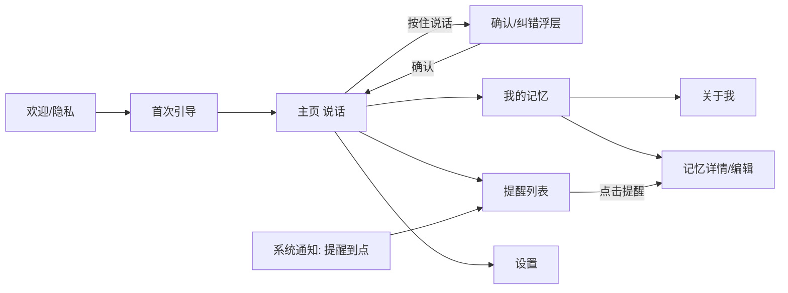

# 语音个人助理 —— 产品原型 v1

> 2026-10-17（UTC+8）
> 范围：只讲产品，不涉及技术实现。
> 定位：**一个更懂我的语音助理**。

## 1. 目标用户与核心价值
### 1.1 目标用户（首批）
| 画像 | 典型场景 | 痛点 |
|---|---|---|
| 忙碌的职场人（28–40 岁） | 开车、通勤、会议间隙随手记事；对客户和同事做过承诺 | 想到的事转头就忘；打字记笔记太慢；提醒 App 设置起来很繁琐 |
| 家庭管理者 | 孩子的事、家务、缴费、证件放在哪 | 信息零碎，到用的时候想不起来 |
| 记性焦虑的人 | 东西放哪了、跟谁说过什么 | 需要一个“第二大脑”，但不想自己整理 |

### 1.2 核心价值
1. **张口就记，开口就问**：按住说话，3 秒内完成记事或设置提醒，不用打字，也不用选分类。
2. **越用越懂我**：会记住你的习惯、偏好、常提到的人和地点，回答和提醒都按你的习惯来。比如它知道你习惯提前 10 分钟提醒，知道“张总”指的是谁。
3. **记忆由我掌控**：它记住的每一条你都能看到、改掉或删掉，也能说一句“忘掉它”。

**不做什么**：不帮你操作别的 App 或电脑；不全天监听；不做闲聊陪伴。

## 2. 用户故事
| # | 作为… | 我想… | 以便… |
|---|---|---|---|
| U1 | 开车的人 | 说一句话就把车位记下来 | 回来时能直接问到 |
| U2 | 职场人 | 用一句话设置提醒，时间说得模糊一点也行 | 不会忘记承诺 |
| U3 | 用户 | 问“我上次跟张总说了什么” | 不用翻聊天记录 |
| U4 | 用户 | 识别错了能马上口头纠正 | 不会存进错误信息 |
| U5 | 用户 | 看到它记住了关于我的哪些信息 | 放心使用 |
| U6 | 用户 | 修改或删除某条记忆，或者让它不再记某一类信息 | 掌控隐私 |
| U7 | 用户 | 它能用我的习惯来设置提醒（比如提前 10 分钟） | 不用每次重复交代 |
| U8 | 新用户 | 1 分钟内体验到“它记住我了” | 决定留下来继续用 |

## 3. MVP 功能范围
| 模块 | 包含 | 不包含 |
|---|---|---|
| 语音记事 | 按住说话；转写结果可以编辑；自动归类为事实、偏好、人物或地点 | 长时间录音、会议纪要 |
| 提醒 | 单次和重复提醒；理解模糊时间（“下班前”会先问一次你几点下班，之后记住）；稍后提醒；标记完成 | 位置提醒、共享提醒 |
| 记忆问答 | 回答时附上依据，点一下能看到来源原话；没有相关记忆时直接说不知道，不编造 | 联网搜索 |
| 记忆查看与编辑 | 按类别浏览；搜索；编辑；删除；“不要再记这类信息”；一键清空；导出 | 多设备同步 |
| 懂我 | “关于我”卡片（偏好、常提到的人、常去的地点）；所有卡片可以修改 | 主动推荐 |

## 4. 页面清单与流程
| 页面 | 作用 |
|---|---|
| P0 欢迎与隐私告知 | 说明价值，展示隐私承诺，请用户同意 |
| P1 首次引导 | 3 步：授权麦克风和通知 → 试说一句 → 让它回忆刚才那句 |
| P2 主页（说话） | 一个大的按住说话按钮，下面是最近的对话卡片 |
| P3 确认与纠错浮层 | 显示识别出的文字和它的理解，可以确认、修改、撤销 |
| P4 提醒列表 | 分“今天”“之后”“已完成”三栏 |
| P5 我的记忆 | 按类别列出，可以搜索，有一键清空入口 |
| P6 记忆详情与编辑 | 显示内容、来源原话、时间，可以编辑、删除，或选“不再记这类” |
| P7 关于我（画像） | 偏好、人物、地点卡片 |
| P8 设置 | 隐私、导出、注销、提醒习惯 |



## 5. ASCII 线框
**P2 主页**
```
┌──────────────────────────────┐
│ ☰        小记           ⚙   │
├──────────────────────────────┤
│ 今天 2 个提醒 ›               │
│ ┌──────────────────────────┐ │
│ │ 🗒 已记住：车停 B2-35     │ │
│ │    09:12           撤销  │ │
│ └──────────────────────────┘ │
│ ┌──────────────────────────┐ │
│ │ ⏰ 明天 15:00 给张总回电话│ │
│ │    已设提醒        修改  │ │
│ └──────────────────────────┘ │
│                              │
│          ╭────────╮          │
│          │  🎙   │          │
│          ╰────────╯          │
│        按住说话，松开发送      │
├──────────────────────────────┤
│  主页     提醒     记忆   我  │
└──────────────────────────────┘
```

**P3 确认与纠错浮层**
```
┌──────────────────────────────┐
│ 你说的是：                    │
│ “下周一早上九点提醒我交房租”   │
│                    ✎ 改文字  │
│ 我理解为：                    │
│ ⏰ 提醒 · 10月19日 周一 09:00 │
│    交房租 · 每月重复？[否 ▾]  │
│                              │
│  [ 撤销 ]          [ 好的 ✓ ]│
│  （2 秒后自动确认）           │
└──────────────────────────────┘
```

**P4 提醒列表**
```
┌──────────────────────────────┐
│ 提醒            今天|之后|已完成│
├──────────────────────────────┤
│ ○ 15:00 给张总回电话          │
│ ○ 18:30 取快递                │
│ ── 之后 ──                    │
│ ○ 10/19 09:00 交房租          │
│                     ＋ 说一个 │
└──────────────────────────────┘
```

**P5 我的记忆**
```
┌──────────────────────────────┐
│ 我的记忆          🔍 搜索      │
│ [全部][事实][偏好][人物][地点] │
├──────────────────────────────┤
│ 车停在 B2-35       今天 09:12 │
│ 不喝咖啡，喜欢美式？✗ 已更正   │
│ 张总 = 张伟，客户公司 CEO      │
│ 护照在书房第二个抽屉           │
├──────────────────────────────┤
│ 关于我 ›        清空全部记忆   │
└──────────────────────────────┘
```

**P6 记忆详情**
```
┌──────────────────────────────┐
│ ‹ 记忆详情                    │
│ 内容：护照在书房第二个抽屉     │
│ 类别：地点/物品               │
│ 来源：“我把护照放书房第二个    │
│        抽屉了” · 10/17 09:40  │
│ 被使用：2 次                  │
│ [ 编辑 ]  [ 删除 ]            │
│ [ 不要再记这类信息 ]          │
└──────────────────────────────┘
```

**P7 关于我**
```
┌──────────────────────────────┐
│ ‹ 关于我（我对你的了解）       │
│ 偏好  · 提醒提前 10 分钟   ✎  │
│       · 不喝咖啡           ✎  │
│ 人物  · 张总=张伟（客户）   ✎  │
│       · 小米=女儿           ✎  │
│ 地点  · 公司：望京 SOHO     ✎  │
│ 作息  · 下班约 18:30        ✎  │
│ 这些都可以改，也可以删         │
└──────────────────────────────┘
```

**P0 欢迎与隐私**
```
┌──────────────────────────────┐
│     🎙 小记：更懂你的语音助理  │
│  说一句就记住，问一句就想起    │
│ ✓ 语音在手机上转文字，录音不上传│
│ ✓ 记住的每一条你都能看、能删   │
│ ✓ 文字会发送到国内大模型处理   │
│   《隐私政策》《第三方清单》   │
│ [ 同意并开始 ]   [ 暂不使用 ]  │
└──────────────────────────────┘
```

## 6. 典型语音对话脚本
| # | 场景 | 对话 |
|---|---|---|
| 1 | 记事 | 我：“记一下，车停在 B2 区 35 号。”<br>助理：“记住了，车停在 B2-35。” |
| 2 | 记忆问答 | 我：“我车停哪了？”<br>助理：“B2 区 35 号，今天早上 9 点 12 分记的。” |
| 3 | 提醒 + 偏好调用 | 我：“明天下午三点给张总回电话，提醒我一下。”<br>助理：“好的。按你的习惯，我会在 2 点 50 分提醒你给张伟回电话。” |
| 4 | 模糊时间 → 澄清并记住 | 我：“下班前提醒我取快递。”<br>助理：“你一般几点下班？”<br>我：“六点半。”<br>助理：“好，6 点 20 提醒你取快递。以后说‘下班前’我都按 6 点半算。” |
| 5 | 识别纠错 | 我：“记一下，王总的电话是一三八……”（识别成了“黄总”）<br>我：“不对，是王总，三横王。”<br>助理：“已改成王总，号码已记下。” |
| 6 | 信息更新（冲突覆盖） | 我：“我现在不喝美式了，改喝拿铁。”<br>助理：“更新了：你现在喜欢拿铁。之前记的美式我已经替换掉了。” |
| 7 | 遗忘 + 确认 | 我：“把关于前公司的记忆都忘掉。”<br>助理：“找到 4 条相关记忆，比如‘前公司在中关村’。确定全部删除吗？”<br>我：“确定。”<br>助理：“已删除 4 条。” |
| 8 | 没有记忆时不编造 | 我：“我上次体检是哪天？”<br>助理：“我这里没有你体检的记录。要我现在记一下吗？” |
| 9 | 跨记忆的问答 | 我：“这周我答应了别人什么？”<br>助理：“有两件：周五前给张伟回电话；周六带小米去上钢琴课。” |
| 10 | 撤销 | 我：“提醒我九点开会。”<br>助理：“好，今晚 9 点。”<br>我：“错了，是明早九点。”<br>助理：“已改成明天早上 9 点。” |

## 7. 首次使用引导（目标 60 秒内完成）
1. **P0**：价值主张和三条隐私承诺 → 用户点“同意”。
2. **授权**：先说明用途，再申请麦克风权限（“只在你按住按钮时听”）；接着申请通知权限（“到点提醒你”）。
3. **试说一句**：屏幕提示“试试说：‘记一下，我最喜欢的水果是芒果’”。
4. **马上回忆**：屏幕提示“现在问我：‘我喜欢什么水果？’”，助理回答，同时出现动画：“这条记忆存在‘关于我’里了”。这一步就是让用户当场感受到“它记住我了”。
5. **可选**：问 2 个问题，建立提醒习惯（提前多久提醒、几点下班），用户可以跳过。
6. 进入主页。

## 8. 隐私告知（产品文案要点）
- **录音不上传**：只在按住按钮时收音，在手机上转成文字后，录音就丢弃。
- **文字的去向**：会发送到我们的服务器，以及国内大模型服务（具体是哪家，在第三方清单里列明），用于理解你说的话、整理记忆；不会用于训练模型（以合同约定为准）。
- **你能控制什么**：查看、编辑、删除任意一条记忆；说“不要再记这类信息”；一键清空；导出；注销账户后彻底删除。
- **默认不记的内容**：健康、宗教、政治、财务账号、密码等敏感信息，除非你明确要求记住。
- 隐私政策和第三方清单在设置页可以随时查看。

## 9. 成功指标（内测 4 周）
| 类别 | 指标 | 目标 |
|---|---|---|
| 激活 | 首次引导完成率 | ≥ 80% |
| 激活 | 首日完成“记一次 + 问一次” | ≥ 60% |
| 留存 | 第 7 天留存 / 第 28 天留存 | ≥ 40% / ≥ 25% |
| 使用 | 人均每天语音交互次数 | ≥ 3 |
| 质量 | 意图理解正确率（用户不撤销、不纠错） | ≥ 90% |
| 质量 | 记忆问答“答对且有依据”（用户反馈加抽检） | ≥ 85% |
| 质量 | 提醒时间正确率 | ≥ 97% |
| 懂我 | 每个用户“关于我”卡片数量（第 14 天）；用户修改画像的比例 | ≥ 5 张；越低越好 |
| 信任 | 一键清空或注销率 | < 5% |
| 体验 | 从松开按钮到播报的延迟中位数 | ≤ 2.5 秒 |
