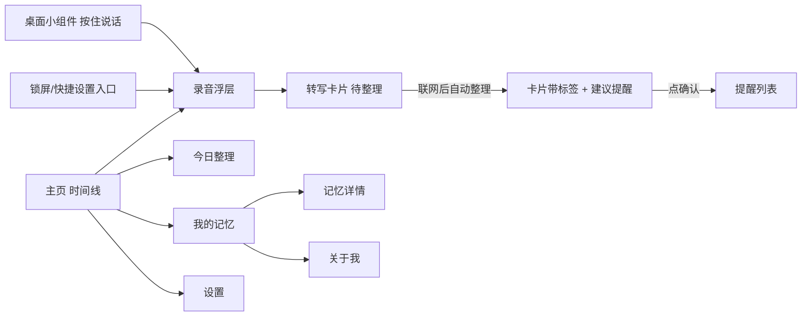

# 语音个人助理 —— 产品原型 v2

> 2026-10-17（UTC+8）
> 基于 [product-prototype-v1.md](./product-prototype-v1.md)。本文只讲产品，不涉及技术实现。
> 说明：我没有收到单独的“原型 v2”需求说明。v2 是按“三阶段演进：随手记 → 接入工具 → 云端语音助理随时可用”这条主线，对 v1 做的修订。v1 里没有改动的部分（用户故事、线框细节、隐私文案）仍然有效。

## 1. 三阶段产品演进
| 阶段 | 一句话 | 用户能感受到的价值 | 关键入口 |
|---|---|---|---|
| **一、随手记（MVP）** | 想到就说，说完不管，它自动整理好 | 零负担记录：自动分类、自动提取待办和提醒、能问回来 | App 里按住说话、桌面小组件、锁屏或快捷设置入口 |
| 二、接入工具 | 记下来的东西能直接变成行动 | 写进日历、待办同步、查地图和天气等，执行前会先跟用户确认 | 和阶段一相同，另外加“去执行”按钮 |
| 三、随时可用的云端语音助理 | 随时能对话，它一直在线 | 实时语音对话、可打断；常驻云端帮你盯事、跟进、主动提醒 | 实时对话模式、耳机或快捷键唤起 |

## 2. 阶段一的核心变化（相比 v1）
1. **入口前置**：除了 App 主页，新增**桌面小组件**（一个按钮，按住就说）和**锁屏/通知栏快捷入口**。目标是从掏出手机到开始说话不超过 2 秒。
2. **自动整理**：用户只管说，系统在后台把每条记录整理好：
   - 归类（想法、事实、待办、提醒、人物、地点）；
   - 提取待办和时间，生成“建议提醒”，用户点一下才生效；
   - 提取关于用户的画像和偏好；
   - 每天生成一份“今日整理”摘要。
3. **离线也能记**：没网的时候照样能录、照样能转写，联网后自动整理，并标记“已整理”。
4. **随手记时间线**：主页按时间显示记录卡片，每张卡片上带整理结果的标签。

## 3. 阶段一功能范围
| 模块 | 包含 |
|---|---|
| 随手记 | 按住说话（App、小组件、锁屏/快捷设置）；端侧转写；转写可编辑；离线缓存 |
| 自动整理 | 分类标签；待办和提醒建议；人物和地点；画像和偏好；今日整理摘要 |
| 提醒 | 一句话直接设提醒，或从建议提醒里一键确认；稍后提醒；标记完成 |
| 记忆问答 | 在 App 里按住问；回答附依据；没有记忆就说不知道 |
| 记忆掌控 | 我的记忆、关于我、编辑和删除、不再记这类信息、清空、导出 |

## 4. 页面与流程（新增小组件、锁屏入口、时间线、今日整理）


**新增或修改的线框**

桌面小组件（2×1）：
```
┌──────────────────────┐
│ 🎙 按住说话   今日 3条 │
└──────────────────────┘
```

录音浮层（从小组件或锁屏拉起，盖在当前界面上，不进入 App）：
```
┌──────────────────────────────┐
│        ● 正在听… 0:04         │
│  “明天上午把合同发给李律师”    │
│      松开保存 · 上滑取消       │
└──────────────────────────────┘
```

主页时间线：
```
┌──────────────────────────────┐
│ 随手记               今日整理 ›│
├──────────────────────────────┤
│ 09:40 把合同发给李律师         │
│   [待办] [人物:李律师]         │
│   💡 建议明天 10:00 提醒  [确认]│
│ 09:12 车停 B2-35   [地点]      │
│ 08:30 ⏳ 待整理（离线）         │
├──────────────────────────────┤
│          ╭────────╮           │
│          │  🎙   │ 按住说话   │
│          ╰────────╯           │
└──────────────────────────────┘
```

今日整理：
```
┌──────────────────────────────┐
│ ‹ 今日整理 10/17              │
│ 待办 2 · 提醒 1 · 新记住 3     │
│ ☐ 把合同发给李律师（明天10:00）│
│ ☐ 取快递                      │
│ 新记住：李律师=李明（律所）    │
└──────────────────────────────┘
```

## 5. 对话脚本补充（在 v1 那 10 条基础上）
| # | 场景 | 对话或交互 |
|---|---|---|
| 11 | 小组件随手记 | 按住小组件说：“周末给老妈买降压药。”松开后弹出 toast：“记下了”。几秒后卡片显示：[待办]、💡 建议周六 10:00 提醒。 |
| 12 | 离线记录 | 地铁上没网，说了一条记录 → 卡片显示“待整理”；出站联网后，卡片自动加上标签。 |
| 13 | 确认建议提醒 | 我：“就按建议的时间提醒我。”助理：“好的，周六上午 10 点。” |

## 6. 成功指标（阶段一，在 v1 基础上调整）
- 入口占比：通过小组件和锁屏入口发起的记录占比 ≥ 40%。
- 自动整理：分类准确率 ≥ 90%；建议提醒的采纳率 ≥ 50%。
- 从按下到开始录音的时间 ≤ 2 秒；离线记录 100% 不丢。
- 其他指标沿用 v1：留存、意图理解正确率、问答正确率、延迟。
