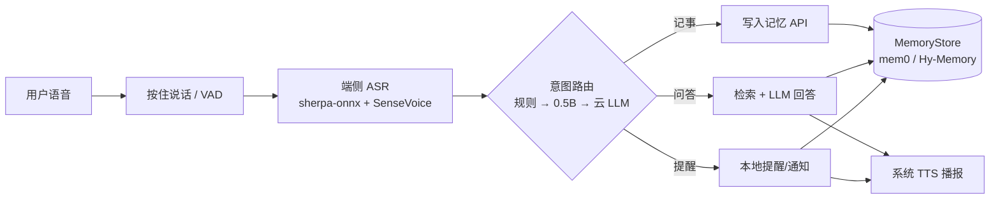

# 移动端语音优先个人 Agent 调研报告 v1

> 撰写：2026-10-17（UTC+8）｜每条事实都附来源；GitHub 星数和提交时间是 2026-10-17 01:15（UTC+8）从 GitHub API 拉取的。标注“待验证”的内容还没有找到一手数据。

---

## 1. 腾讯混元 Hy-Memory 2.0

### 1.1 是什么
- **发布时间**：2026-10-16。腾讯混元在这一天发布了 Hy Memory 2.0，**模型、记忆框架、MemHub 应用三层一起开源**。三层可以单独用，也可以组合起来用。官方称它已经用在腾讯内部的金融、资讯、知识管理、办公 Agent、社交娱乐、游戏等业务里。来源：[官网](https://memory.hunyuan.tencent.com/)、[第一财经](https://www.yicai.com/news/103397004.html)、[IT之家](https://www.ithome.com/1/014/108.htm)
- **模型层**：Hy-Memory-30B-A3B（MoE 结构，总参数 30B，激活约 3B），权重放在 Hugging Face：<https://huggingface.co/tencent/Hy-Memory-30B-A3B>。HF API 显示协议是 apache-2.0。IT之家标题说它“性能超 Opus5”，这是厂商的说法，还没有独立复现。
- **框架层**：Hy-Memory SDK，Python 包 `hy-memory`，PyPI 上的版本是 2.0.1，要求 Python ≥3.9，描述为 “Industrial-grade dual-system cognitive memory framework”。来源：[PyPI](https://pypi.org/project/hy-memory/)
- **应用层**：MemHub 是一个本地记忆管理应用，提供 CLI 和 **macOS App**。它能导入约 10 种 AI 工具（Cursor、Codex、OpenCode、WorkBuddy 等）的历史会话，存成本地记忆，再以插件方式召回给这些工具。来源：[官网](https://memory.hunyuan.tencent.com/)
- **论文**：[Hy-Memory 2.0, arXiv 2610.22196](https://arxiv.org/pdf/2610.22196)；1.0 版本（DCPM）是 arXiv 2606.09483（链接取自官网）。

### 1.2 开源协议
- **SDK 用 MIT，MemHub 用 Apache-2.0**，两者在同一个 monorepo 里，各自适用各自的协议。来源：[PyPI README](https://pypi.org/project/hy-memory/)。GitHub API 识别出的协议是 `NOASSERTION`，原因就是一个仓库里有多个协议。
- 模型权重：HF 卡片标的是 apache-2.0。正式商用之前，建议逐条读一遍 LICENSE 原文。

### 1.3 架构和 API（已公开的部分）
- monorepo 的结构：`hy_memory/`（SDK）、`memhub/`（macOS App、CLI、本地 Runtime/Core、Web UI、各种集成）、`plugins/`（SDK 层面的集成）。来源：[PyPI README](https://pypi.org/project/hy-memory/)
- 安装命令：`pip install hy-memory==2.0.1`。MemHub 的构建方式是 `pnpm install` 加 `uv sync`。
- “双系统认知记忆”具体怎么设计、API 的函数签名，**本次没有读到详细文档**，需要看仓库 docs 和论文（待验证）。

### 1.4 部署要求
- SDK 只要 Python ≥3.9。它是服务端或桌面端的库，**没有 iOS/Android SDK**。
- MemHub 只出了 macOS 版。
- 30B-A3B 模型需要 GPU 服务器（30B 总参数，BF16 权重大约 60GB，这是按参数量推算的，没有官方显存数据），**不可能放在手机上跑**。

### 1.5 成熟度
- 仓库是 [Tencent-Hunyuan/Hy-Memory](https://github.com/Tencent-Hunyuan/Hy-Memory)：**263 星**，最近一次 push 在 2026-10-17 00:30（UTC+8），刚发布一天。
- 官网列出的 `github.com/Tencent-Hunyuan/MemHub` 用 API 查是 **404**；MemHub 实际放在 Hy-Memory 仓库的 `memhub/` 目录下。

### 1.6 适不适合当记忆底座
- **好的地方**：协议宽松（MIT/Apache）；有专用的记忆抽取模型，可以自己部署，数据不出国；腾讯内部业务在用；对中文场景比较友好。
- **风险**：刚发布，社区很小，API 的稳定性还看不出来；只有 Python/服务端；没有移动端案例。
- **建议**：MVP 用一个抽象的 `MemoryStore` 接口，**先接 mem0（最成熟），同时把 Hy-Memory 当 A/B 候选**，等 2–4 周看它的迭代情况再决定。

### 1.7 替代方案对比
| 方案 | 思路 | 协议 | 星数 / 最近提交 | 移动端适配 | 备注 |
|---|---|---|---|---|---|
| [mem0](https://github.com/mem0ai/mem0) | LLM 从对话里抽取事实，用向量检索 + 图 | Apache-2.0 | 约 67.3K / 2026-09-25 前后 | 服务端，有 Python/TS SDK | README 写的是 LoCoMo 92.5、LongMemEval 94.4，p50 约 1s（厂商自测） |
| [Letta (MemGPT)](https://github.com/letta-ai/letta) | 把记忆块放进上下文，再加归档记忆，是一个有状态 Agent 平台 | Apache-2.0 | 25,166 / 2026-09-10 | 服务端 | 仓库已经指向 letta-code（[Dexio](https://dexio.wiki/guides/mem0-alternatives/)）；更像一个平台，不是能直接调用的记忆层 |
| [Zep / Graphiti](https://github.com/getzep/graphiti) | 带时间的知识图谱 | Apache-2.0（Graphiti） | 约 31.8K | 需要自己备图数据库 | Zep 社区版已经停用；托管版 $125/月起（[Dexio](https://dexio.wiki/guides/mem0-alternatives/)） |
| [MemOS](https://github.com/MemTensor/MemOS) | 记忆操作系统，SQLite + FTS5 + 向量的本地插件 | Apache-2.0 | 约 11.9K / v2.0.34（2026-09） | 有“100% 本地”插件 | 国内团队（MemTensor），中文社区活跃 |
| Hy-Memory 2.0 | 双系统记忆 + 专用 30B-A3B 模型 | MIT / Apache-2.0 | 263 / 2026-10-17 | 服务端 | 见上文 |

---

## 2. 竞品对比表
| 产品 | 定位 | 核心功能 | 定价 | 优点 | 缺点 / 现状 |
|---|---|---|---|---|---|
| **Limitless Pendant**（前身是 Rewind） | 随身录音吊坠 + 可搜索的记忆 | 全天录音、转写、摘要 | **已停售** | 曾是这个品类里产品做得最完整的 | 2025-12-05 被 Meta 收购，停止销售；Rewind 已关停；中国、欧盟等地区停止服务；现有用户支持到 2026 年底（[官网](https://www.limitless.ai/)、[Reuters](https://www.reuters.com/business/meta-acquires-ai-wearables-startup-limitless-2025-12-05/)） |
| **Plaud NotePin / NotePin S** | 手动触发的会议录音笔 | 录音、转写、AI 摘要 | $159 / $179；每月免费 300 分钟，Pro $99.99/年，Unlimited $239.99/年 | 成熟，输出质量稳定 | 需要手动开启，订阅费偏贵（[Memsist](https://memsist.com/devices/)、[Layer3](https://www.layer3labs.io/guides/best-ai-wearable-pendants-2026)） |
| **Bee** | 常开录音手环 | 自动转写，生成摘要和待办 | $49.99，没有强制订阅 | 便宜，续航约一周 | 2025-07 被 Amazon 收购；只支持美国和 iOS；隐私上有顾虑（[Reuters](https://www.reuters.com/business/retail-consumer/amazon-buy-startup-focused-ai-wearables-2025-07-22/)、[Memsist](https://memsist.com/devices/)） |
| **Friend** | AI 陪伴项链 | 常开监听，以陪聊为主 | $249；超过 30 天的记忆要 $10/月 | 情感陪伴方向做得很明确 | 不是效率工具（[Memsist](https://memsist.com/devices/)） |
| **Omi** | 开源的常开设备 | 转写、记忆，开发者可以扩展 | $179；Unlimited $29.99/月 | 开源 | 硬件体验一般（[Layer3](https://www.layer3labs.io/guides/best-ai-wearable-pendants-2026)） |
| **豆包（实时语音 + 记忆）** | 国民级 AI 助手 | 端到端实时语音（低延迟、可随时打断、能联网）；可以从实时通话转写里提取记忆，记忆能查看、删除、关闭 | App 免费 | 中文语音体验最强之一，用户量大 | 记忆不是实时生效的；个人助理“小豆”还在内测（[微信公众号](https://mp.weixin.qq.com/s/CIiS5WJO7u97sJ9Ui2dtTw)、[记忆FAQ](https://www.doubao.com/legal/memory_faq)、[AI热报](https://airebao.com/item/43164)） |
| **腾讯元宝** | 混元 C 端助手 | 语音和文字搜索、文档处理；“元宝助手”（个人 Agent、长期记忆）在开发中 | 免费 | 有微信生态的信息源 | 暂时没查到已上线的语音记忆功能（[AI热报](https://airebao.com/item/43164)） |
| **Siri AI / Apple Intelligence** | 系统级个人助手 | 理解个人上下文（信息、邮件、日历、备忘录、提醒事项）、屏幕感知、App 动作、iCloud 同步对话；手表有 Live Rewind | 系统自带 | 系统权限最深，端侧隐私做得好 | 2026-09 发布，目前是英文 Beta，**中文还没列入支持**；高级端侧模型需要 12GB 内存的机型（[Apple Newsroom](https://www.apple.com/newsroom/2026/09/siri-ai-a-profoundly-more-capable-and-personal-assistant-is-here/)、[Apple Support](https://support.apple.com/en-us/127893)） |

**小结**：独立录音硬件这个品类基本被大厂收购或关停了，Memsist 的总结是：持有私人数据的小公司最后往往被收购，或者产品下线（[Memsist](https://memsist.com/devices/)）。中文市场里，“手机 App 语音优先 + 长期记忆”这个位置，Siri AI 还没覆盖中文，豆包和元宝的个人 Agent 还没正式上线，现在还有窗口期，但大概只有几个月。

---

## 3. 手机端本地方案
### 3.1 唤醒词
| 方案 | 协议 / 成熟度 | iOS | Android | 说明 |
|---|---|---|---|---|
| [Porcupine (Picovoice)](https://github.com/Picovoice/Porcupine/) | 商业 SDK（个人免费额度和价格要看官网） | ✅ 有后台监听的 demo | ✅ 有 PorcupineManager | 轻量，官方称比 PocketSphinx/Snowboy 准 11 倍、快 6.5 倍（Raspberry Pi 3 上测的） |
| [openWakeWord](https://github.com/dscripka/openWakeWord) | Apache-2.0，2,850 星，最近提交 2025-12-30 | 需要自己移植 ONNX | 需要自己移植 | 能自己训练唤醒词，但没有官方的移动端 SDK，维护也比较慢 |
| sherpa-onnx 关键词检测 | Apache-2.0 | ✅ | ✅ | 和 ASR 用同一套运行时（具体效果待验证） |

注意：iOS 对 App 在后台常开麦克风限制很严，MVP 建议用**按住说话**，或者用系统的 Siri Shortcut / Action Button 触发，先不做常开唤醒。

### 3.2 端侧 ASR
| 方案 | 数据 | 来源 |
|---|---|---|
| **sherpa-onnx + SenseVoice Small**（中、英、日、韩、粤语） | 模型约 240MB；Android 上 30 秒音频转写用 1.725s（RTF 0.06）；iOS 15.6 词/秒；RK3588 A76 单线程 RTF 0.099；支持 Android 和 iOS arm64；支持 VAD 伪流式 | [sherpa 文档](https://k2-fsa.github.io/sherpa/onnx/sense-voice/index.html)、[基准测试](https://github.com/voiceping-ai/android-offline-transcribe)、[VoicePing](https://voiceping.net/en/blog/research-offline-speech-transcription-benchmark/) |
| **whisper.cpp**（MIT，54.4K 星） | Tiny 模型 31MB；在这次测试的 Android 配置下 30 秒音频要 105.6s（RTF 3.52）；iOS 37.8 词/秒。Android 上必须调好编译和线程配置 | 同上，[仓库](https://github.com/ggml-org/whisper.cpp) |
| sherpa-onnx Zipformer 流式 | 20M 参数，约 46MB，真流式（100ms 一块） | 同上 |
| 系统 ASR（Android SpeechRecognizer / iOS Speech） | Android 离线 30 秒音频 3.6s | [基准测试](https://github.com/voiceping-ai/android-offline-transcribe) |

结论：**中文首选 sherpa-onnx + SenseVoice**（sherpa-onnx 15.3K 星，最近提交 2026-10-16）。需要注意，上面基准测试用的是英文音频，中文的准确率要自己测。

### 3.3 端侧 0.5B 小模型做意图识别
- 模型：[Qwen2.5-0.5B-Instruct](https://huggingface.co/Qwen/Qwen2.5-0.5B-Instruct)（Apache-2.0），可以用 llama.cpp、MLC 或 MNN 跑。
- 延迟和内存：有二手资料说 Q4 量化下峰值内存约 400–750MB，低端 Android 约 8–12 tok/s。**本次没有找到可靠的一手基准，标为待验证**，第 1 周需要自己实测。
- 可行性判断：意图分类只需要输出一个短 JSON（20–40 个 token），按 10 tok/s 推算延迟在 1–3 秒，**勉强能用**。更好的做法是**规则和关键词先挡一层**（“提醒我…”“记一下…”“我上次…”），只有拿不准的再交给 0.5B 模型或云端 LLM；也可以考虑用 BERT 级的小分类器（几十 MB，延迟在毫秒级）。

---

## 4. MVP 建议（2 周）
### 4.1 场景（窄）
1. 语音记事：“记一下，车停在 B2 区 35 号” → 存成一条记忆。
2. 提醒：“明天下午三点提醒我给张总回电话” → 用本地通知实现。
3. 基于记忆的问答：“我车停哪了？” → 检索记忆，再由 LLM 回答，结果用语音播报。

### 4.2 技术栈
- 客户端：Flutter 或 React Native，**先只做 Android**（后台和麦克风限制少），iOS 放到第二阶段。
- 交互：按住说话，加上 Silero VAD。
- ASR：sherpa-onnx + SenseVoice int8，跑在端侧。如果效果不好，退回云端 ASR。
- 意图：规则 → 端侧 Qwen2.5-0.5B（可选）→ 云端 LLM 兜底，三层逐级处理。
- 记忆：服务端 FastAPI + mem0（向量库用 Qdrant 或 pgvector），通过 `MemoryStore` 接口和 Hy-Memory SDK 做 A/B。
- LLM：混元、Qwen、DeepSeek 等国内 API（合规，延迟低）。
- TTS：系统 TTS。

### 4.3 架构图

### 4.4 两周里程碑
| 时间 | 交付 |
|---|---|
| D1–2 | 搭好 Android 工程；接入 sherpa-onnx + SenseVoice，跑通按住说话出文字；在 2–3 台真机上测延迟和中文准确率 |
| D3–4 | 意图路由：规则加云端 LLM 的 function-call，输出 {note, reminder, query}；同时实测 Qwen2.5-0.5B 的端侧延迟和内存 |
| D5 | 服务端用 FastAPI + mem0 实现写入和检索；定义 MemoryStore 接口 |
| **第 1 周验收** | 能说一句话记下来，也能问出来 |
| D6–7 | 提醒：解析时间（LLM 加 dateparser），接本地通知；提醒也写进记忆 |
| D8 | 问答链路：检索 + LLM + TTS；记忆的查看和删除页面 |
| D9 | 接入 Hy-Memory SDK 做 A/B；用 50 条自建中文问答集评测召回率 |
| D10 | 打磨、埋点、隐私说明；**第 2 周验收**：内部 5–10 人试用 |

### 4.5 主要风险
1. **隐私与合规**：语音和记忆都是敏感个人信息（《个人信息保护法》）。需要明确告知并取得同意，数据存在境内，并且支持删除。
2. **ASR 准确率**：口音、噪音、人名和专有名词会影响效果，需要热词功能，必要时退到云端 ASR。
3. **iOS 限制**：后台常开麦克风和唤醒词受限，iOS 版只能走 Shortcut 或按住说话。
4. **记忆质量**：可能抽错、存重复、信息过时（比如“车位”会变），需要能更新和覆盖，并能追溯来源。
5. **端侧小模型**：0.5B 模型在低端机上延迟和准确率可能都不够，要保证云端兜底。
6. **大厂挤压**：豆包“小豆”、元宝助手、Siri 中文版都可能在几个月内上线。差异化要放在“跨 App 的个人记忆 + 本地优先 + 可导出”上。
7. **Hy-Memory 成熟度**：刚发布一天，API 可能还会变，所以要用接口隔离。
