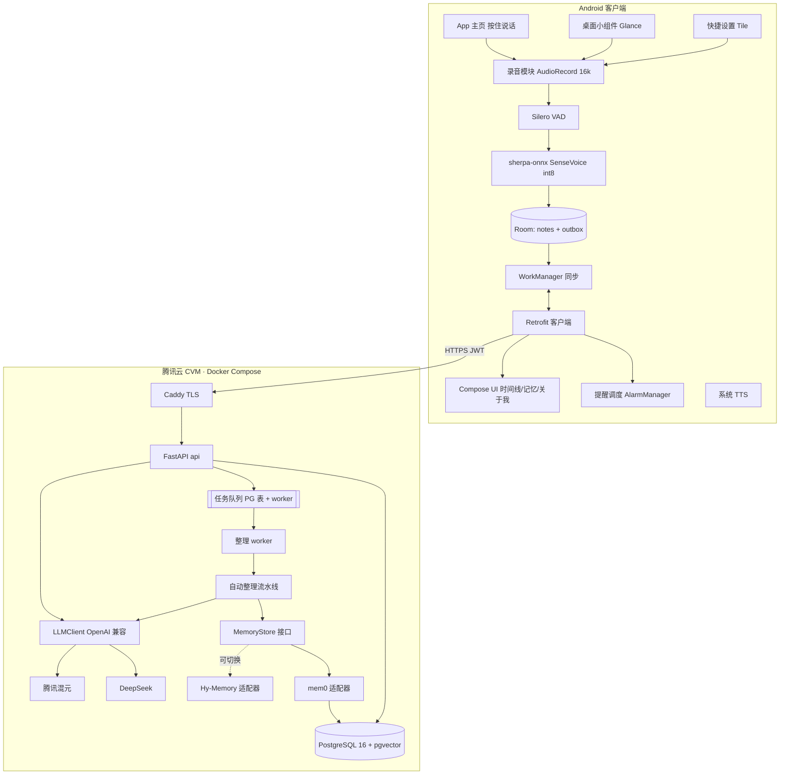
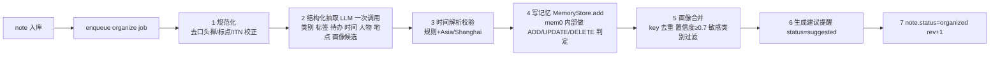
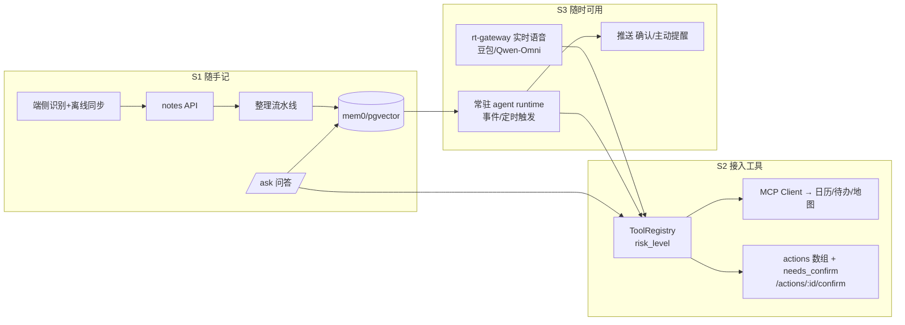

# 技术架构 v1（三阶段演进）

> 2026-10-17（UTC+8）
> 依据：[product-prototype-v2.md](./product-prototype-v2.md)、[design-v2.md](./design-v2.md)、[ai-native-arch.md](./ai-native-arch.md)
> 已定技术栈：Android 原生 Kotlin + Compose + sherpa-onnx SenseVoice；腾讯云 + Python 3.12 FastAPI + PostgreSQL/pgvector + mem0（可切换到 Hy-Memory）+ Docker Compose + Caddy；LLM 走 OpenAI 兼容接口，可以配置 DeepSeek 或混元。
> 标注“需验证”的内容，还要通过真机测试或官方文档确认。**所有价格都没有核实**。

## 0. 三阶段总览
| 阶段 | 产品形态 | 架构关键点 |
|---|---|---|
| **S1 随手记（MVP，2 周）** | 多入口语音记录 + 自动整理 + 提醒 + 记忆问答 | 端侧识别、离线优先同步、异步整理流水线、记忆层抽象 |
| S2 接入工具 | 记录可以变成行动（日历、待办、地图等） | ToolRegistry、MCP 工具接入、`actions[]` 加确认标记 |
| S3 云端语音助理随时可用 | 实时语音对话 + 常驻 agent | 实时语音网关、常驻 agent 运行时（定时、事件触发）、推送 |

---

## 1. S1 系统架构


**两条主链路**
1. **记录链路（异步，离线优先）**
   - 端侧识别出文本后，先写进本地 Room，并放入 outbox（待上传队列）。
   - 同步任务调用 `POST /v1/notes`，服务端写入数据库后立即返回 202。
   - worker 在后台跑自动整理，客户端通过拉取 `GET /v1/sync` 拿到整理结果。
2. **问答和命令链路（同步）**
   - 端侧识别后调用 `POST /v1/ask`，服务端检索记忆、调用 LLM 生成回答，客户端用 TTS 播报。
   - 如果服务端判断这句话其实是提醒或记事，就在响应里返回对应的处理结果。

---

## 2. Android 客户端模块
| 模块 | 职责 | 关键实现要点 |
|---|---|---|
| `:app` | Compose 导航（时间线、提醒、记忆、关于我、设置），Hilt 依赖注入 | minSdk 26，targetSdk 用最新稳定版 |
| `:feature-capture` | 录音、VAD、按住说话手势，录音浮层 Activity | `AudioRecord` 16kHz 单声道；单段最长 60 秒；松开结束，上滑取消 |
| `:feature-asr` | 封装 sherpa-onnx：模型下载和校验、识别引擎生命周期 | SenseVoice int8 模型约 240MB，首次启动在 Wi-Fi 下下载并做 SHA256 校验；打开逆文本规范化；识别引擎常驻在 ViewModel 作用域内，空闲 5 分钟后释放 |
| `:feature-entry` | 桌面小组件（Jetpack Glance），快捷设置 Tile（`TileService`） | **桌面小组件不支持“按住”手势，只能响应点击**。所以点小组件会打开一个透明的录音浮层 Activity：打开即开始录音，松手、再点一下或 VAD 检测到说完就结束。Tile 在锁屏状态下能否直接拉起录音、要不要先解锁，**需要真机验证**；Android 14 以上从后台启动收音受限，所以录音必须放在前台的 Activity 里进行 |
| `:data` | Room 表（notes、outbox、reminders、memories_cache、sync_state）；Retrofit；仓库层 | 离线优先：UI 只读本地数据库，服务端结果同步回来后再更新本地 |
| `:sync` | WorkManager 任务：上传 outbox、增量拉取 | 有网络就触发，失败后指数退避重试；用幂等键 `client_note_id`（UUID）防止重复提交 |
| `:feature-reminder` | `AlarmManager.setExactAndAllowWhileIdle` + 通知；开机或升级后重新排程 | Android 12 以上需要“精确闹钟”权限，Android 13 以上需要通知权限；被拒绝时降级为不精确闹钟，并提示用户 |
| `:core-security` | 用 EncryptedSharedPreferences 存 token；Room 数据库加密（SQLCipher，可选） | `allowBackup=false` |

**离线与同步规则**
- 笔记的状态流转：`local` → `uploaded` → `organized`（失败时为 `failed`）。
- 冲突处理：服务端的版本号 `rev` 每次修改加 1。客户端编辑时带上旧的 rev，版本对不上时返回 409，客户端拉取最新版本后让用户选择保留哪个。
- 增量同步：`GET /v1/sync?since=<cursor>`，返回从 cursor 之后变化过的笔记、提醒、记忆，以及被删除的 id 列表。

---

## 3. 腾讯云服务端模块
```
server/app/
  api/        auth, notes, ask, reminders, memories, profile, sync, me, health
  auth/       邀请码 + 设备注册，JWT 签发与刷新、吊销
  pipeline/   自动整理流水线（worker 执行）
  memory/     MemoryStore 接口；mem0、hymemory、inmemory 三种实现
  llm/        LLMClient（OpenAI 兼容，主备切换、超时、重试、计费埋点）
  intent/     /ask 用的轻量路由（规则快路径 + LLM）
  db/         SQLAlchemy 2 async 模型，Alembic 迁移
  jobs/       基于 PG 的任务队列（SELECT … FOR UPDATE SKIP LOCKED），定时任务
  obs/        日志、指标、链路追踪
```

### 3.1 自动整理流水线（每条笔记跑一次，异步执行）

- **一次 LLM 调用完成抽取**：输出按 JSON Schema 约束。结构：`{category, tags[], todos[{text, due?}], people[], places[], profile_candidates[{key, value, type, confidence}]}`。
- **失败处理**：最多重试 3 次，之后标记为 `failed`，客户端卡片上显示“整理失败，点击重试”。
- **今日整理**：每天 21:00 跑一个定时任务（以用户时区为准），生成当天的摘要，存成一条 `digest`。
- **遗忘**：每天跑一次定时任务。fact 和 event 过了 `expires_at` 就降权，超过 30 天归档；用户删除的记忆立即硬删除，包括 mem0 里的向量。

### 3.2 记忆层
- 接口：`add`、`search`、`list`、`get`、`update`、`delete`、`delete_all`，全部按 user_id 隔离。
- **默认 mem0**：向量库用 pgvector（和业务库同一个 PostgreSQL 实例，单独一个 schema `mem0`）；mem0 内部调用的 LLM 和 embedding 也走同一个 OpenAI 兼容配置。
- **embedding 模型**：DeepSeek 是否提供 embedding 接口没有核实。可选的做法：用混元 embedding（混元是否有 OpenAI 兼容的 embedding 接口，需要验证），或者在本地容器里跑开源 bge-m3 之类的模型（会增加约 2GB 内存）。**这一项需要用户决定。**
- **Hy-Memory 适配器**：用 `MEMORY_BACKEND=hymemory` 切换。用同一套评测集（50 条中文问答）对比两个后端的召回率和延迟。
- **检索打分**：`score = 相似度 × 时间衰减(半衰期按类型设置) × 类型权重(profile/preference 1.2，fact 1.0，event 0.9)`。

### 3.3 LLM 层
- 统一的 `chat(messages, tools?, response_format?)` 接口。配置项：`LLM_BASE_URL`、`LLM_API_KEY`、`LLM_MODEL`，另有一套 `*_FALLBACK` 作为备用。
- 按用途分两档模型：`MODEL_FAST` 用于抽取和意图，`MODEL_ANSWER` 用于问答。
- 超时 15 秒，最多重试 2 次；主供应商连续失败 5 次就熔断，切到备用供应商。
- 每次调用记录 token 用量（`llm_usage` 表），用于成本统计和按用户限额。

---

## 4. 数据模型（PostgreSQL）
| 表 | 关键字段 |
|---|---|
| users | id, created_at, timezone, status, settings_json |
| devices | id, user_id, name, platform, refresh_token_hash, last_seen, revoked_at |
| invite_codes | code, max_uses, used, expires_at |
| notes | id, user_id, client_note_id(UNIQUE per user), text_enc, source(app/widget/tile), asr_meta_json, recorded_at, status, category, tags[], rev, deleted_at |
| reminders | id, user_id, note_id?, title, fire_at, rrule?, status(suggested/scheduled/done/cancelled), rev |
| profile_items | id, user_id, key, value, type(profile/preference/person/place), confidence, source_note_id, updated_at；唯一键 (user_id, key) |
| profile_blocklist | user_id, key_or_category |
| memory_refs | memory_id(mem0 id), user_id, note_id, type, expires_at, archived |
| digests | id, user_id, date, content |
| jobs | id, kind, payload, status, attempts, run_after, locked_at |
| llm_usage | id, user_id, purpose, model, prompt_tokens, completion_tokens, created_at |
| audit_log | id, user_id, action, target, created_at（不存原文） |
| mem0.* | mem0 自己管理的向量表和历史表 |

`text_enc` 是用 AES-GCM 在应用层加密后的原文；密钥从环境变量或 KMS 读取。向量本身没法加密，靠用户隔离和磁盘加密来保护。

---

## 5. API 定义（S1）
- 基础路径 `/v1`，只走 HTTPS，请求头 `Authorization: Bearer <access>`。
- 错误统一为 `{"error":{"code":"...","message":"..."}}`。

| 方法与路径 | 请求 | 响应 |
|---|---|---|
| POST /auth/login | `{invite_code, device_id, device_name}` | `{access_token, refresh_token, expires_in, user_id}` |
| POST /auth/refresh | `{refresh_token}` | 同上（refresh token 每次轮换） |
| POST /auth/logout | — | 204 |
| POST /notes | `{client_note_id, text, recorded_at, timezone, source, asr:{engine, confidence, duration_ms}}` | 202 `{note_id, status:"uploaded", rev}`（用 client_note_id 保证幂等） |
| PATCH /notes/{id} | `{text, rev}` | 200 `{note, rev}`，版本冲突返回 409；修改后会触发重新整理 |
| DELETE /notes/{id} | — | 204（关联的记忆一起删除） |
| GET /sync?since= | — | `{cursor, notes[], reminders[], profile_items[], digests[], deleted:{notes[], reminders[], memories[]}}` |
| POST /ask | `{text, client_time, timezone}` | `{intent:"query"\|"reminder"\|"note"\|"clarify", answer, speak, citations:[{memory_id, text, note_id, recorded_at}], created?:{note?, reminder?}}` |
| GET /reminders?status= | — | `{items[]}` |
| POST /reminders | `{title, fire_at, rrule?}` | `{reminder}` |
| PATCH /reminders/{id} | `{status?, fire_at?, rev}` | `{reminder}`；建议提醒由用户确认时，就是把 status 从 suggested 改成 scheduled |
| GET /memories?type=&q=&cursor= | — | `{items:[{id, text, type, source_note_id, created_at, used_count}], next_cursor}` |
| PATCH /memories/{id} | `{text}` | `{memory}` |
| DELETE /memories/{id} | — | 204 |
| DELETE /memories | `{confirm:"DELETE_ALL"}` | 204 |
| GET /profile | — | `{items:[{key, value, type, confidence, updated_at}]}` |
| PATCH /profile/{key} / DELETE /profile/{key} | `{value}` | 200 / 204 |
| POST /profile/blocklist | `{key_or_category}` | 204 |
| GET /me/export | — | JSON 文件 |
| DELETE /me | `{confirm:"DELETE_ACCOUNT"}` | 202（异步执行硬删除） |
| GET /healthz | — | `{ok:true, db, llm}` |

## 6. 鉴权
- **登录**：MVP 用邀请码加设备注册。之后接手机号验证码（需要用户决定是否接入，并配套短信服务）。
- **access token**：JWT，HS256，有效期 15 分钟，`sub` 是 user_id，`did` 是设备 id。
- **refresh token**：随机生成 256 位，服务端只存哈希，有效期 30 天，每次使用都换新的。如果检测到同一个 refresh token 被重复使用，就吊销这台设备。
- **限流**：按用户设上限（`/ask` 每分钟 20 次，`/notes` 每分钟 60 次），按 IP 限制登录接口；超限返回 429。
- **数据隔离**：所有查询都必须带 `user_id`。数据库访问层强制加上这个条件，并有测试覆盖“用户 A 读不到用户 B 的数据”。

## 7. 隐私与安全
1. 音频不出手机：转写完成后就丢弃 PCM，任何日志都不包含原文。
2. 全链路 TLS（Caddy 自动申请证书）。云盘加密；原文在应用层加密；备份也加密，保留 7 天后轮换。
3. 画像抽取默认过滤敏感类别（健康、宗教、政治、性取向、财务账号、证件号），过滤在 prompt 约束和规则后处理两层同时做。
4. 用户完全掌控：查看、编辑、删除任意记忆或画像，屏蔽某类信息，清空，导出，注销后硬删除（包括 mem0 向量；备份在过期后自然清除）。
5. 防 prompt 注入：笔记内容拼进 prompt 时作为数据放在分隔符里；LLM 只能按 schema 输出，S1 阶段没有任何可执行的工具。
6. 合规：遵守《个人信息保护法》，需要单独同意，并公开第三方清单（DeepSeek 或混元）；数据存储在中国大陆。

## 8. 部署（Docker Compose + Caddy）
| 服务 | 镜像 | 资源 |
|---|---|---|
| caddy | caddy:2 | 公网只开放 80 和 443 |
| api | 自建，基于 python:3.12-slim，uvicorn 2 个 worker | 约 512MB |
| worker | 和 api 同一个镜像，命令改成 `python -m app.jobs.worker` | 约 512MB |
| postgres | pgvector/pgvector:pg16 | 约 1–1.5GB，用数据卷持久化 |
| （可选）embedding | 开源 embedding 模型服务 | 约 2GB（如果自己部署 embedding） |

- **机器**：腾讯云 CVM 2 核 4GB 起步（自己部署 embedding 的话用 4 核 8GB），60GB SSD 云盘，大陆地域。服务端不需要 GPU。
- **发布**：GitHub Actions 构建镜像，推到腾讯云镜像仓库（TCR），然后 SSH 到服务器执行 `docker compose pull && up -d`。启动时自动跑 Alembic 迁移。
- **备份**：每天凌晨 pg_dump，加密后上传到腾讯云 COS，保留 7 天。
- **ICP 备案**：用域名对外服务前必须完成。备案期间用 IP 加自签证书做内测，客户端固定信任这张证书。
- **配置**：`.env` 里放 LLM key、JWT 密钥、加密密钥、数据库密码，不进 git；仓库里提供 `.env.example`。

## 9. 可观测性
- **日志**：结构化 JSON，包含 request_id、user_id 的哈希、路由、耗时、状态码，**不记录原文**。
- **指标**（Prometheus 格式的 `/metrics`，只在内网可访问）：
  - 请求量和 p50/p95 延迟（重点看 `/ask`）；
  - 整理流水线的排队时长和成功率；
  - LLM 调用次数、延迟、错误率、token 用量（按用途分）；
  - 记忆检索耗时。
- **客户端埋点**：识别耗时、从松开按钮到播报的端到端延迟、离线队列长度、入口来源占比（App、小组件、Tile）。
- **告警**：MVP 用简单方式实现（Uptime 探测 `/healthz`，错误率超过阈值就推送到企业微信或邮件）。
- **评测**：`eval/` 目录放意图评测集、抽取评测集、问答评测集，每次改 prompt 都要跑一遍回归。

## 10. 成本估算（价格均未核实，以官网为准）
**用量假设**：内测 100 个用户，每人每天记录 10 条、提问 3 次。
| 项 | 估算方法 | 量级 |
|---|---|---|
| 整理用的 LLM | 每条约 800 输入 token + 300 输出 token | 每天约 1,000 次，约 110 万 token |
| 问答用的 LLM | 每次约 2,000 输入 token（带检索到的记忆）+ 200 输出 token | 每天约 300 次，约 66 万 token |
| mem0 内部的 LLM 和 embedding | 每次写入额外 1–2 次 LLM 调用 + embedding | 大约和整理的用量相当（需验证） |
| 合计 | | **每天约 300 万 token，每月约 1 亿 token** |
| 云服务器 | 2 核 4GB CVM + 60GB 云盘 + 带宽 | 按腾讯云官网报价计算（未核实） |
| 对象存储备份 | 少于 10GB | 很低 |

- 月 LLM 费用 ≈ 1 亿 token × 所选模型的单价，单价以 DeepSeek 或混元官网为准，本文没有核实。
- **省钱措施**：
  - 整理和抽取用便宜的快模型；
  - 规则快路径能处理的不调 LLM；
  - 尽量利用供应商的缓存命中价格；
  - 把 mem0 的写入判断和整理合并成一次调用（需要定制 mem0 的配置或适配器）。

---

## 11. S2 接入工具：演进点
1. **ToolRegistry**：工具用 `name`、`description`、`input_schema`（JSON Schema）和 `risk_level`（read/write/high）描述，能导出成 OpenAI tools 格式和 MCP `tools/list` 格式。S1 里的记事、提醒、问答都改成通过注册表调用。
2. **MCP 工具接入**：服务端作为 MCP Client，连接外部 MCP Server（日历、待办、地图、天气等）。每个用户的授权（OAuth）单独存放、加密，可以随时撤销。另外，把我们自己的记忆能力作为 MCP Server 对外提供（可选）。
3. **`/v1/ask` 改为返回 `actions[]`**：
```json
{"intent":"tool","speak":"要把“周五给张总回电话”加到你的日历吗？",
 "actions":[
  {"id":"act_1","type":"tool_call","tool":"calendar.create_event",
   "params":{"title":"给张总回电话","start":"2026-10-23T15:00:00+08:00"},
   "risk_level":"write","needs_confirm":true},
  {"id":"act_2","type":"speak","params":{"text":"..."},"needs_confirm":false}]}
```
   - 确认：`POST /v1/actions/{id}/confirm`，服务端执行后返回结果。`risk_level=high` 的动作要求在手机上做生物识别验证。
   - 客户端只执行本地动作（`speak`、`schedule_reminder`）；远程工具一律由服务端执行，并写审计日志。
4. 新增表：`tool_connections`（用户授权）、`action_log`（动作日志，可撤销的记录 undo 信息）。

## 12. S3 云端语音助理随时可用：演进点
1. **实时语音网关**
   - 新增 `rt-gateway` 服务（WebSocket，或者用 WebRTC 透传），对接端到端语音模型，比如火山引擎的豆包实时语音，或百炼的 Qwen-Omni Realtime（见 ai-native-arch 第 3 节）。
   - 记忆和工具通过 function calling 回调到我们的服务端。
   - 这一阶段**音频会上云**，需要单独征得用户同意，并且只在“对话模式”下启用；随手记仍然在端侧识别。
2. **常驻云端 agent**
   - 每个用户有一个 agent 实例。它由事件触发（新笔记、提醒到点、日历变化）或定时触发（早报、晚间整理），状态存在 PostgreSQL 里。
   - 具体能力：主动跟进（“昨天说要发合同，发了吗？”）、合并重复待办、按画像个性化。
   - 运行时：在 jobs 队列基础上加一个 `agent_runs` 表。每次运行限制步数和预算，执行有副作用的工具时同样走确认流程（通过推送通知让用户确认）。
3. **推送**：国内要接各厂商推送通道或聚合推送服务（具体选哪家待定），用于确认请求和主动提醒。
4. **随时可用的入口**：耳机按键、Android 助理入口（设置成默认数字助理，需要验证）。唤醒词放到这一阶段再评估（Porcupine 或 sherpa-onnx KWS，见 research-v1 第 3.1 节）。
5. **远期**（保持 design-v2 的口径）：手机操作（GUI 或系统意图）、电脑操作（云沙箱或本机代理）。



## 13. 需要用户决定的事项
1. **embedding 用哪个**：混元 embedding、其他云端 embedding，还是自己部署 bge-m3（会提高服务器配置要求）。
2. **主力和备用 LLM**：DeepSeek 还是混元，以及确认使用的具体型号。
3. **腾讯云地域、域名和 ICP 备案主体**。
4. **登录方式**：继续用邀请码，还是接手机号验证码。
5. **S3 的音频上云**：是否接受这件事，以及实时语音选哪家供应商。
6. **推送服务**选哪家（S3 才需要）。
